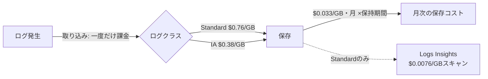

## TL;DR

- 2026年10月28日、AWS Price List Bulk API（認証不要の公開エンドポイント）から東京リージョンのCloudWatch Logsの単価を取得して検証した。
- 取り込み（Ingestion）は、Standardログクラスで **$0.76/GB**、Infrequent Access（IA）ログクラスで **$0.38/GB**。保存（Storage）は、どちらのログクラスでも **$0.033/GB-月**。
- 1GBのログをStandardクラスで保持する場合、保持期間を90日から30日に縮めても、浮くのは**$0.066（総コストの約7.7%）**にしかならない。取り込み分の$0.76は保持期間を変えても一切減らないため。
- 同じ90日保持のまま、ログクラスをStandardからIAに変えるだけで**$0.38浮く（総コストの約44%）**。保持期間を1/3に削るより、クラスを変えるほうが6倍近く効く。
- IAクラスには機能面の制約があるとされている。本記事では制約の詳細を公式ドキュメントで確認できなかった（理由は参考リンクの節に記載）ため、移行前に必ず自分の用途で確認してほしい。

## 背景：「保持期間を短くする」は定番の節約Tipsだが、実際にどれだけ効くのか

CloudWatch LogsのコストTipsとして、「ロググループの保持期間を短くする」はよく紹介される。
確かに保存コストは減るが、CloudWatch Logsの課金はそもそも**取り込み（Ingestion）**と**保存（Storage）**の2系統に分かれていて、取り込みは保持期間を何日に設定しても一度きりの課金で変わらない。

本記事はAWSコスト検証シリーズ（FSx、CodePipeline V2、Route53+CloudWatchの死活監視）の続きとして、CloudWatch Logs自体の課金構造を、公式の単価データだけを使って検証する。

## 単価を取得する

AWS Price List Bulk APIは認証不要で、追加コストもかからない公開エンドポイントである。東京リージョン（ap-northeast-1）のCloudWatch Logsの単価は次のコマンドで取得できる。

```bash
curl -s "https://pricing.us-east-1.amazonaws.com/offers/v1.0/aws/AmazonCloudWatch/current/ap-northeast-1/index.json" \
  -o cw_tokyo.json
```

取得したJSONから、`operation` が `PutLogEvents` の項目（ログの取り込み・保存に関する単価）を抽出すると、2026年10月28日時点で次の値が確認できた。

| 項目 | ログクラス | 単価（東京リージョン） |
| --- | --- | --- |
| 取り込み（Ingestion） | Standard | $0.76 / GB |
| 取り込み（Ingestion） | Infrequent Access（IA） | $0.38 / GB |
| 保存（Storage） | Standard / IA 共通 | $0.033 / GB-月 |
| Logs Insightsクエリでスキャンしたデータ | Standard | $0.0076 / GB |

取り込みは「ログがCloudWatch Logsに書き込まれた時点」で1回だけ課金される。保存は「保持期間中、毎月」課金される。この2つは課金のタイミングが違うという点が、今回の検証の前提になる。

## 検証：「保持期間を短くする」と「ログクラスを変える」、どちらが効くか

1GBのログを保持期間 $R$ か月のあいだ保持したときの総コストは、次の式になる。

```
Standardクラス: 総コスト = 0.76 + 0.033 × R
IAクラス     : 総コスト = 0.38 + 0.033 × R
```



保持期間ごとの総コスト（1GBあたり）は次のようになる。

| 保持期間 | Standard 総コスト | IA 総コスト | IAで浮く額 | IAでの削減率 |
| --- | --- | --- | --- | --- |
| 30日（≒1か月） | $0.793 | $0.413 | $0.380 | 47.9% |
| 90日（≒3か月） | $0.859 | $0.479 | $0.380 | 44.2% |
| 180日（≒6か月） | $0.958 | $0.578 | $0.380 | 39.7% |
| 365日（≒12か月） | $1.156 | $0.776 | $0.380 | 32.9% |

一方、Standardクラスのまま保持期間だけを90日→30日に縮めた場合はこうなる。

```
0.859（90日） − 0.793（30日） = 0.066
0.066 ÷ 0.859 ≒ 7.7%
```

保持期間を1/3に縮めても、浮くのは総コストの7.7%。
対して、保持期間は90日のまま、ログクラスをStandardからIAに変えるだけで44.2%浮く。
「保持期間を縮める」という、設定変更としては地味な作業のほうが注目されがちだが、実際に効くのは「取り込み時点のログクラス」のほうだった。

さらに言うと、取り込みコストと保存コストが同額になる保持期間（損益分岐点）を計算すると、

```
Standard: 0.76 ÷ 0.033 ≒ 23.0か月
IA     : 0.38 ÷ 0.033 ≒ 11.5か月
```

Standardクラスの場合、保存コストが取り込みコストに追いつくまで約23か月かかる。多くのチームが設定する保持期間（30〜180日）では、保存コストは総コストのごく一部にしかならない。

## Q&A

**Q. なぜ「保持期間を短くする」が節約Tipsとして広く紹介されているのですか？**
A. 保持期間はコンソールから1クリックで変更できる設定項目で、直感的に「期間を減らせばコストも減る」と理解しやすいためだと考えられる。ただし今回の検証の通り、取り込みコストが全体の大部分を占める環境では効果が小さい。

**Q. ログクラスの変更にデメリットはありますか？**
A. IAログクラスは取り込み単価が安い一方、一部の機能に制約があるとされている。本記事を書いている時点で、このセッションのネットワーク環境から `docs.aws.amazon.com` および `aws.amazon.com` に接続できず、制約の詳細を公式ドキュメントで確認できなかった。移行する前に、自分が使っている機能（メトリクスフィルタ、Logs Insightsでのクエリなど）がIAクラスで使えるか、必ず公式ドキュメントで確認してほしい。

**Q. ログの保存量は、取り込んだバイト数と同じですか？**
A. CloudWatch Logsの保存コストは圧縮後のデータ量に対して課金されるとする情報がある（本記事ではAWS公式ドキュメントで確認できていない、Web検索で見つかった複数の二次情報に基づく）。圧縮率はログの内容によって変わるため、本記事の計算は「取り込みバイト数＝保存バイト数」という単純化した前提で行っている。実際の圧縮率次第では、保存コストの比率はここで示した値よりさらに小さくなる可能性がある。

**Q. この単価は今も有効ですか？**
A. いいえ。本記事の単価は2026年10月28日にAWS Price List Bulk APIから取得した値。リージョンや時期によって変わるため、実際に検討する際はAWS公式のCloudWatchの料金ページで必ず確認してほしい。

## 得られた知見・まとめ

- CloudWatch Logsのコストは「取り込み（一度だけ）」と「保存（毎月）」の2系統に分かれている。保持期間の設定を変えられるのは保存コストだけで、取り込みコストには一切効かない。
- 1GBのログをStandardクラスで持つ場合、保持期間を90日から30日に縮めても浮くのは総コストの約7.7%。一方、保持期間を変えずにログクラスをIAに変えるだけで約44%浮く。設定変更1つの手間に対する効果は、後者のほうが大きい。
- 保存コストが取り込みコストに追いつく損益分岐点は、Standardクラスで約23か月。多くの環境ではこれより短い保持期間で運用しているため、「保持期間を削る」施策は想像より効果が薄いことが多い。
- 自分の環境でどちらが効くかを判断するには、まず取り込み量（GB/月）と保存量（保持期間）の内訳を数値で出すことが先。内訳を出さずに「保持期間を縮める」から着手すると、今回の検証のように効果が小さい施策から時間を使ってしまう。

## 参考リンク

このセッションのネットワーク環境では `aws.amazon.com` / `docs.aws.amazon.com` への接続が許可されておらず、AWS公式の料金ページ・ドキュメントのURLをcurlでHTTPステータス確認できなかった。そのため、本記事で検証に使った単価データの取得元（curlでHTTP 200を確認済み）のみを参考リンクとして載せる。

- [AWS Price List Bulk API（オファーインデックス）](https://pricing.us-east-1.amazonaws.com/offers/v1.0/aws/index.json)
- [AWS Price List Bulk API（Amazon CloudWatch・東京リージョン）](https://pricing.us-east-1.amazonaws.com/offers/v1.0/aws/AmazonCloudWatch/current/ap-northeast-1/index.json)

最新の料金・機能の制約については、AWS公式の「Amazon CloudWatchの料金」ページと「CloudWatch Logsユーザーガイド」で確認してほしい。
