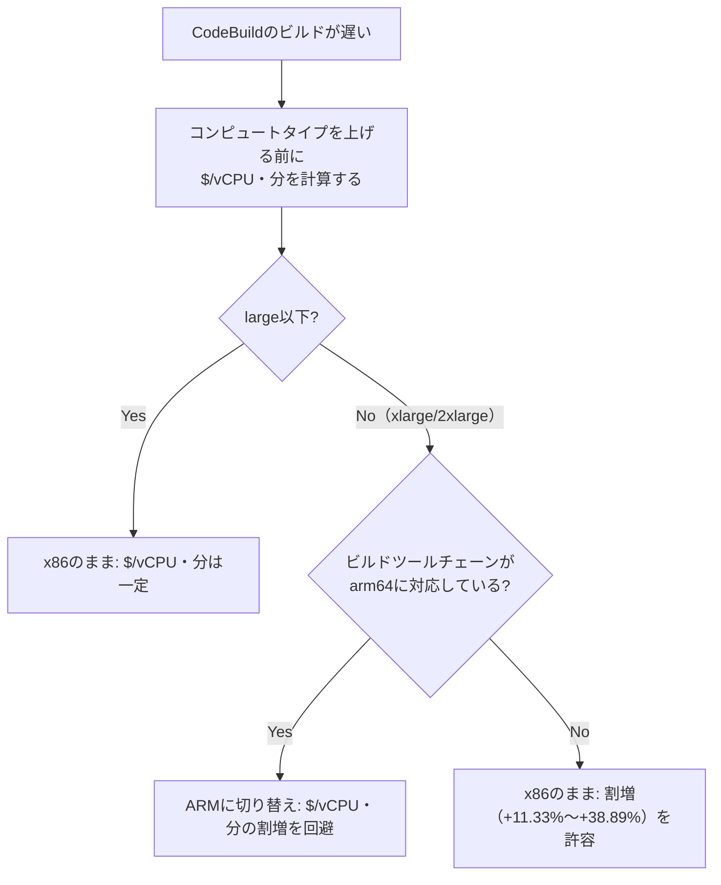

## TL;DR

- AWS Price List Bulk API（公式・無認証で取得可能）から、2026年10月24日時点の東京リージョン（ap-northeast-1）のCodeBuild単価を取得した。
- x86（Linux）の **small / medium / large** は、いずれも **$0.0025 / vCPU・分** で完全に一致していた（線形）。
- ところが **xlarge は $0.002783 / vCPU・分（+11.33%）、2xlarge は $0.003472 / vCPU・分（+38.89%）** と、同じ「$/vCPU」基準から外れて割高になっていた。
- ARM（Graviton系）は large〜2xlarge まで **$0.0025 / vCPU・分で一定**。small/mediumはx86よりさらに安い（-15.0% / -10.0%）。
- つまり「コンピュートタイプを上げれば単純にvCPU数倍の金額になる」という前提は、x86のxlarge以上では崩れる。

以前の記事「CodePipeline V2でビルドを1つ足すと、月額が最大2.7倍になる」ではアクション単位の二重課金を扱ったが、今回は同じCodeBuildの「コンピュートタイプの選び方」に焦点を当てる。

## 背景・課題

CodeBuildのビルドが遅いとき、最初に検討されるのがコンピュートタイプの変更（small→medium→large→xlarge→2xlarge）だ。
「vCPUが2倍になれば、料金も2倍になるだけ」という前提で検討しているケースを見かけるが、この前提が東京リージョンのx86系列で本当に成り立つのか、公式の単価そのものを取得して確認した。

CodeBuildの料金ページにはコンピュートタイプごとの$/分は載っているが、「$/vCPU・分」という正規化した形では載っていない。
正規化しないと、「xlargeは単に大きいから高い」のか「大きいこと自体に割増が乗っている」のかを区別できない。

## 具体的な取り組み

### 1. AWS Price List Bulk APIから単価を取得する

AWS Price List Bulk APIは認証なしでHTTPS GETできる公式エンドポイントである。CodeBuildのサービスコードは `CodeBuild`。

```bash
curl -sS -m 20 \
  "https://pricing.us-east-1.amazonaws.com/offers/v1.0/aws/CodeBuild/current/ap-northeast-1/index.json" \
  -o codebuild_tokyo.json
```

取得日時: 2026-10-24（取得した `index.json` の `publicationDate` フィールドで確認可能。単価はAWSの都合で変更されるため、利用時は必ず同じ方法で取り直すか、公式のCodeBuild料金ページで最新値を確認してほしい）。

### 2. Linux（x86）とARMの `usagetype` を抽出する

`products` の `attributes.usagetype` が `APN1-Build-Min:Linux:g1.*`（x86）と `APN1-Build-Min:ARM:g1.*`（ARM）のSKUを、`terms.OnDemand` から単価と紐づけて取り出す。

```python
import json
with open("codebuild_tokyo.json") as f:
    data = json.load(f)

products = data["products"]
terms = data["terms"]["OnDemand"]

rows = []
for sku, p in products.items():
    ut = p["attributes"].get("usagetype", "")
    if ut.startswith("APN1-Build-Min:Linux:g1.") or ut.startswith("APN1-Build-Min:ARM:g1."):
        for term in terms.get(sku, {}).values():
            for dim in term["priceDimensions"].values():
                rows.append((ut, dim["pricePerUnit"]["USD"],
                             p["attributes"].get("vcpu"), p["attributes"].get("memory")))
for r in sorted(set(rows)):
    print(r)
```

実際の出力（2026-10-24取得分、抜粋）:

```
('APN1-Build-Min:ARM:g1.2xlarge', '0.1200000000', '48', '96 GiB')
('APN1-Build-Min:ARM:g1.large', '0.0200000000', '8', '16 GiB')
('APN1-Build-Min:ARM:g1.medium', '0.0090000000', '4', '8 GiB')
('APN1-Build-Min:ARM:g1.small', '0.0042500000', '2', '3 GB')
('APN1-Build-Min:ARM:g1.xlarge', '0.0800000000', '32', '64 GiB')
('APN1-Build-Min:Linux:g1.2xlarge', '0.2500000000', '72', '144 GiB')
('APN1-Build-Min:Linux:g1.large', '0.0200000000', '8', '15 GB')
('APN1-Build-Min:Linux:g1.medium', '0.0100000000', '4', '7 GB')
('APN1-Build-Min:Linux:g1.small', '0.0050000000', '2', '3 GB')
('APN1-Build-Min:Linux:g1.xlarge', '0.1002000000', '36', '72 GiB')
```

### 3. $/vCPU・分に正規化する

$/分をvCPU数で割るだけだが、この「割った後」の値を並べないと線形からの逸脱が見えない。

**x86（Linux）**

| タイプ | vCPU | メモリ | $/分 | $/vCPU・分 | 基準（small）との差 |
| --- | --- | --- | --- | --- | --- |
| small | 2 | 3 GB | $0.005 | $0.002500 | ±0% |
| medium | 4 | 7 GB | $0.010 | $0.002500 | ±0% |
| large | 8 | 15 GB | $0.020 | $0.002500 | ±0% |
| xlarge | 36 | 72 GiB | $0.1002 | $0.002783 | **+11.33%** |
| 2xlarge | 72 | 144 GiB | $0.250 | $0.003472 | **+38.89%** |

**ARM**

| タイプ | vCPU | メモリ | $/分 | $/vCPU・分 | 基準（small）との差 |
| --- | --- | --- | --- | --- | --- |
| small | 2 | 3 GB | $0.00425 | $0.002125 | -15.00% |
| medium | 4 | 8 GiB | $0.009 | $0.002250 | -10.00% |
| large | 8 | 16 GiB | $0.020 | $0.002500 | ±0% |
| xlarge | 32 | 64 GiB | $0.080 | $0.002500 | ±0% |
| 2xlarge | 48 | 96 GiB | $0.120 | $0.002500 | ±0% |

x86はsmall/medium/largeの3段階が完全に線形（$0.0025/vCPU・分）なのに、xlargeと2xlargeだけ割増になっている。
ARMはlarge以上もすべて$0.0025/vCPU・分のままで、x86のような割増が見られない。



### 4. この数字だけで分かること・分からないこと

分かること: 東京リージョンの「今の」単価の構造として、x86はxlarge/2xlargeで$/vCPUが上がる。ARMはlarge以上で上がらない。

分からないこと: 実際のビルドが、コンピュートタイプを上げてどれだけ速くなるかはワークロード依存であり、本記事では計測していない。ビルドがCPUバウンドでなければ（I/O待ちが主なら）、タイプを上げても時間が短縮されず、$/vCPUの割増分がそのまま損失になる。逆にCPUバウンドな処理（大量の並列コンパイル等）なら、割増を払っても十分な時間短縮で相殺できる可能性がある。この判断に必要な「自分のビルドの時間短縮効果」は、本記事の数値では代替できないため、各自の環境で実際に計測してから判断してほしい。

## Q&A

**Q. なぜx86のxlarge/2xlargeだけ割高なのか？**
A. AWSは価格の内訳理由を公開しておらず、確認した範囲（Price List Bulk APIのレスポンス）では分からない。あくまで「現時点の単価を正規化すると割高になっている」という観測結果。

**Q. 他のリージョンでも同じ傾向か？**
A. 未確認。本記事はap-northeast-1（東京）のみを取得した。同じ `curl` のURLを `ap-northeast-1` の部分だけ変更すれば、他リージョンも同じ手順で確認できる。

**Q. ARMに変えれば常に得か？**
A. 単価の計算上はlarge以上で割増が出ないというだけで、ビルドイメージ・依存ツールがarm64対応している必要がある。移行コスト（Dockerイメージの作り直し、CIスクリプトの検証など）は別途かかる。

**Q. 単価は今後も同じか？**
A. 保証されない。AWSの価格は変更されるため、本記事の数値を根拠に意思決定する場合は、利用する時点で同じ手順（Price List Bulk API、または公式のCodeBuild料金ページ）で単価を取り直すことを推奨する。

## 知見・まとめ

- CodeBuildのコンピュートタイプは「vCPU数に比例した値段」という前提は、x86ではlarge以下でしか成り立たない。xlarge/2xlargeは$/vCPU・分で見ると割増（+11.33%／+38.89%、東京リージョン・2026-10-24時点）。
- ARMはlarge〜2xlargeまで$/vCPU・分が一定。large以上に上げる場合、ビルドツールチェーンがarm64に対応しているなら検討の価値がある。
- ただし「単価」だけでは「実際にどれだけ速くなるか」は分からない。コンピュートタイプを上げる判断は、必ず自分のビルドで実測した時間短縮効果と、この$/vCPU・分の表を両方見て行うこと。

## 参考リンク

- AWS公式のCodeBuild料金ページ（コンピュートタイプ別の単価の最新値はこちらで確認してください。リージョン・時期によって変動します）
- AWS Price List Bulk APIのドキュメント（本記事と同じ方法で単価を取得する場合の公式リファレンス）

---

CI/CDのコスト構造を手を動かして確認する一連の内容は、Udemyの[実践！AWS CI/CDパイプライン構築マスター講座](https://www.udemy.com/course/aws-cicd/)でも扱っています。
