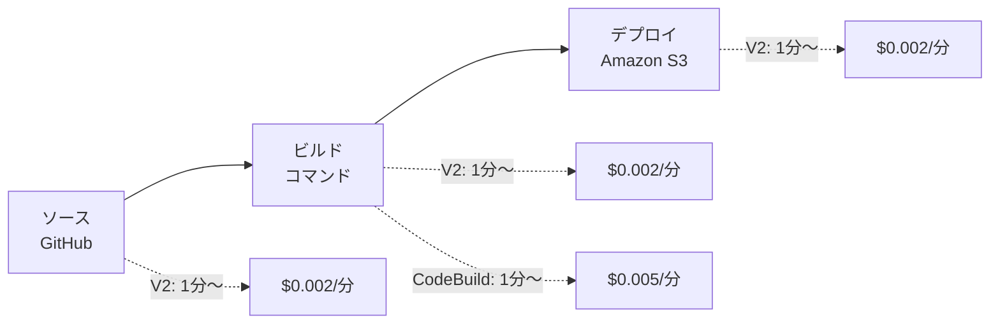

## TL;DR

- 2026年10月17日時点の東京リージョンのCodePipeline作成画面では、パイプラインの種類を選ぶ欄がなく、作ると **V2** になる（レビュー画面に「V2」と表示される）。
- V2は **アクションの実行時間（1分単位で切り上げ）** に課金される。ソースもデプロイも、1アクション1回で最低1分。
- ビルドステージの初期値は「コマンド」で、画面にも「AWS CodeBuild では別途料金が発生します」と書かれている。つまりビルドの時間は、**V2のアクション分（$0.002/分）と、CodeBuildの分（$0.005/分）の2回** 数えられる。
- 東京リージョンの単価で試算すると、GitHub→S3 の静的サイト用パイプライン10本・月300回ずつ実行の場合、ビルドなしで **月$11.80**、ビルドを1つ足すと **月$32.30**（約2.7倍）。
- 静的サイトのように「ビルドが要らない」構成なら、ビルドステージはスキップするのが一番安い。

## 背景

CodePipelineは「パイプライン1本 月$1」というイメージを持っている人が多いと思います。
これはV1の料金で、V2は課金の単位がまったく違います。

| 種類 | 課金の単位 | 東京リージョンの単価 | 無料枠 |
| --- | --- | --- | --- |
| V1 | アクティブなパイプライン1本あたり | $1.00/月 | 1本/月 |
| V2 | アクションの実行時間（分、切り上げ） | $0.002/分 | 100分/月（アカウント内のV2全体で共有） |

そして、2026年10月17日に東京リージョンでパイプライン作成ウィザードを最後（「パイプラインを作成する」の手前）まで進めたところ、次のようになっていました。

- パイプラインの設定画面に、V1とV2を選ぶ欄がない
- レビュー画面の「パイプラインタイプ」は **V2**、「実行モード」は **QUEUED**
- ビルドステージ（Step 4 of 7）の「プロバイダーを構築する」は、初期値が **コマンド**
- その下に「このアクションにコンピューティング時間を使用すると、AWS CodeBuild では別途料金が発生します」という注意書き

つまり、今コンソールから作るパイプラインはV2で、ビルドを入れると課金が2系統になります。
どれくらい差が出るのかを、東京リージョンの実際の単価で計算しました。

## 単価は Price List API から取る

料金ページはリージョン別の単価が載っていないことがあるので、AWS Price List API から直接取りました。
Price List API の呼び出し自体は無料です（エンドポイントは us-east-1 か ap-south-1）。

```bash
# CodePipeline（東京）
aws pricing get-products --region us-east-1 \
  --service-code AWSCodePipeline \
  --filters Type=TERM_MATCH,Field=regionCode,Value=ap-northeast-1 \
  --query 'PriceList[]' --output text \
  | jq -r '.terms.OnDemand[].priceDimensions[] | "\(.description)\t\(.pricePerUnit.USD)"'

# CodeBuild（東京、general1.small の Linux）
aws pricing get-products --region us-east-1 \
  --service-code CodeBuild \
  --filters Type=TERM_MATCH,Field=regionCode,Value=ap-northeast-1 \
  --query 'PriceList[]' --output text \
  | jq -r 'select(.product.attributes.usagetype=="APN1-Build-Min:Linux:g1.small")
           | .terms.OnDemand[].priceDimensions[] | "\(.description)\t\(.pricePerUnit.USD)"'
```

2026年10月18日に取得した結果です。

| usagetype | 内容 | 単価（USD） |
| --- | --- | --- |
| APN1-actionExecutionMinute | V2のアクション実行時間 | 0.002 / 分 |
| APN1-activePipeline | V1のアクティブなパイプライン | 1.00 / 本 |
| APN1-trialPipeline | 作成から30日以内のV1 | 0.00 |
| APN1-Build-Min:Linux:g1.small | CodeBuild general1.small | 0.005 / 分 |

## なぜ「2回数えられる」のか

V2の課金対象は「手動承認とカスタムアクション以外の、すべてのアクション」です。
ビルドのアクション（コマンドでも、CodeBuildプロジェクトでも）もその中に入ります。
一方、コマンドのアクションは、ドキュメントに「CodePipelineが管理するCodeBuildのコンピューティングで動き、CodeBuildで別途料金が発生する」と書かれています。



ビルドの1分は、アクションとしての $0.002 と、CodeBuildとしての $0.005 の両方がかかります。
1分あたりで見ると、ビルドはソースやデプロイの **3.5倍** の値段です。

## 試算：GitHub → S3 の静的サイト

前提は次のとおりです。

- 各アクションは1回1分以内に終わる（切り上げで1分。V2もCodeBuildも最低1分）
- ビルドなし：ソース＋デプロイ ＝ 1回あたり V2 2分
- ビルドあり：ソース＋コマンド＋デプロイ ＝ 1回あたり V2 3分 ＋ CodeBuild 1分
- 無料枠（V2 100分、CodeBuild 100分）は、ほかに使っていないものとする

### パイプライン1本

| 月の実行回数 | ビルドなし | ビルドあり | 内訳（ビルドあり） |
| --- | --- | --- | --- |
| 30回 | $0.00 | $0.00 | V2 90分、CodeBuild 30分。どちらも無料枠内 |
| 100回 | $0.20 | $0.40 | V2 (300−100)×0.002、CodeBuild 100分は無料枠内 |
| 300回 | $1.00 | $2.60 | V2 (900−100)×0.002 ＝ $1.60、CodeBuild (300−100)×0.005 ＝ $1.00 |

### パイプライン10本（チームでリポジトリごとに1本）

無料枠はアカウント全体で共有なので、本数が増えると効かなくなります。

| 1本あたりの月の実行回数 | ビルドなし | ビルドあり | 倍率 |
| --- | --- | --- | --- |
| 100回 | $3.80 | $10.30 | 2.7倍 |
| 300回 | $11.80 | $32.30 | 2.7倍 |

300回×10本の内訳（ビルドあり）は、V2 (9,000−100)×0.002 ＝ $17.80、CodeBuild (3,000−100)×0.005 ＝ $14.50 です。
年額にすると、1ドル150円で ビルドなし 約21,000円、ビルドあり 約58,000円になります。

金額そのものは大きくありません。
ただ、「ビルドが要らない構成なのに、初期値のまま何か入れてしまった」場合は、差額がまるごと無駄になります。

## V1を使い続けるべきケース

既存のV1パイプラインをV2に移すかどうかも、同じ計算で判断できます。

- V1は1本 $1.00/月（2本目から。1本目は無料枠）
- V2で $1.00 になるのは、500分

ソース＋ビルド＋デプロイの3アクション（各1分）なら、**月167回** 実行するとV1と同じ金額です。
これより多く動くパイプラインは、V1のほうが安いことになります。
ただし、コマンドのアクションのようにV2でしか使えない機能もあります。
コマンドのアクションは、ドキュメントで「V2のパイプラインでだけ使える」とされています。

## 無駄を出さないための手順

1. **ビルドが要らない構成なら、ビルドステージをスキップする**
   静的サイトをそのままS3に置くだけなら、ビルドは不要です。
   作成画面のStep 4で「ビルドステージをスキップ」を押します。
2. **デプロイで「デプロイする前にファイルを抽出する」を選ぶ**
   ソースの出力はZIPなので、選ばないとZIPのままバケットに届きます。
   ビルドで展開しようとして、ビルドを足すのは遠回りです。
3. **レビュー画面で、パイプラインタイプとステージの数を見る**
   「パイプラインを作成する」を押す前に、V2であることと、要らないステージが入っていないことを確かめます。
4. **既存のパイプラインのアクション数を数える**
   次のコマンドで、ステージとアクションの一覧が出ます。

```bash
aws codepipeline get-pipeline --name <パイプライン名> \
  --query 'pipeline.{type:pipelineType,stages:stages[].{stage:name,actions:actions[].actionTypeId.provider}}'
```

## Q&A

**Q. ソースのアクションも課金されるのですか？**
A. 料金ページの説明では、課金されないのは手動承認とカスタムアクションだけです。ソースのアクションも1回1分（切り上げ）として数えます。

**Q. CodeBuildの無料枠は、いつまで使えますか？**
A. CodeBuildの料金ページでは、general1.small の月100分の無料枠は12か月で切れず、新規・既存のどちらのアカウントでも使えると説明されています。ただし、アカウント内のほかのCodeBuildプロジェクトと共有です。

**Q. ビルドを入れるなら、コマンドとCodeBuildプロジェクトのどちらが安いですか？**
A. どちらもCodeBuildのコンピューティングを使い、V2のアクションとしても数えられるので、課金の構造は同じです。違いは、コマンドはビルドプロジェクトを作らなくてよい点です。

**Q. 実行時間が1分を超えるとどうなりますか？**
A. V2は1分単位で切り上げです。たとえば、デプロイが1分10秒かかれば2分として数えます。この試算は「すべて1分以内」の前提なので、実際の金額はこれより大きくなることがあります。

## まとめ

- 今コンソールから作るCodePipelineはV2で、課金はアクションの実行時間（分）。
- ビルドを入れると、その時間はV2とCodeBuildの2回数えられ、1分あたりの単価はソースやデプロイの3.5倍になる。
- 東京リージョンの単価で、10本×月300回なら、ビルドなし 月$11.80、ビルドあり 月$32.30。
- 要らないビルドはスキップし、レビュー画面でステージを確かめてから作成する。

## 参考リンク

- [AWS CodePipeline の料金](https://aws.amazon.com/jp/codepipeline/pricing/)
- [AWS CodeBuild の料金](https://aws.amazon.com/jp/codebuild/pricing/)
- [Commands action reference（CodePipeline ユーザーガイド）](https://docs.aws.amazon.com/codepipeline/latest/userguide/action-reference-Commands.html)
- [AWS Price List Query API](https://docs.aws.amazon.com/awsaccountbilling/latest/aboutv2/using-price-list-query-api.html)

---

GitHubからS3へのパイプラインを、実際の画面で1ステップずつ作る講座を公開しています。
[実践！AWS CI/CDパイプライン構築マスター講座（Udemy）](https://www.udemy.com/course/aws-cicd/)
