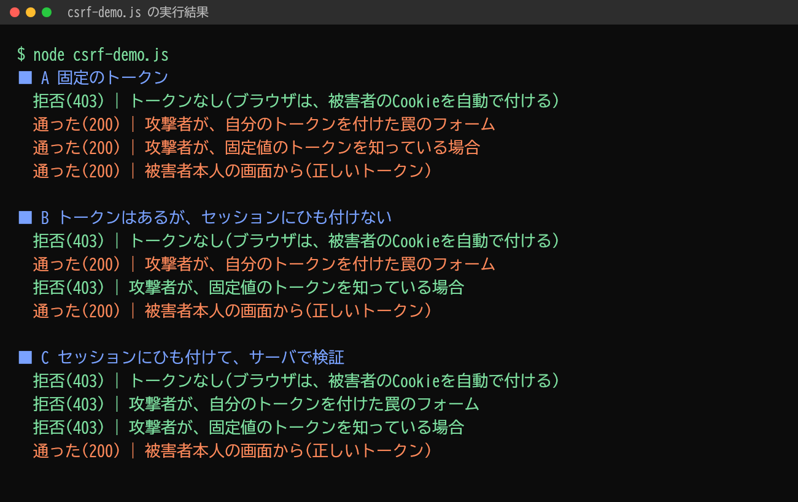

## はじめに

自作のWordPressプラグイン(在庫管理)の管理画面を診断したところ、CSRFトークン(nonce)が、10画面すべてで同じ固定値でした。
しかも、サーバ側では検証されていませんでした。
直す過程で、「トークンがある」だけでは足りないことを、実験で確認しました。
この穴は、情報処理安全確保支援士の過去問(令和6年度 春期 午後 問3)と、同じ形でした。

この記事では、次のことを書きます。

- CSRFが成立する条件(3つ)
- 3つの作りに、同じ攻撃を試した実験(Node.js・コピーして動かせます)
- 実験の結果と、過去問との対応
- WordPressでの直し方と、補助の対策の比較

## CSRFとは

CSRF(Cross-Site Request Forgery / サイトをまたいだ、リクエストの偽造)は、ログイン中の利用者に、意図しない操作をさせる攻撃です。
攻撃者は、パスワードもCookieも知りません。
盗むのではなく、本人のブラウザに、操作させます。

成立する条件は、3つです。

1. 利用者が、ログイン中である。
2. ブラウザが、Cookieを自動で付けて送る。
3. サーバが、依頼の出どころを確かめない。

2が要点です。
ブラウザは、サイトへの依頼であれば、どのページから送られたかに関係なく、そのサイトのCookieを付けます。
そのため、罠のページから送られた依頼も、サーバには、本人の操作と同じに見えます。

## 診断で見つけたコード

修正前は、10の画面に、同じ値のhidden入力がありました。

```html
<input type="hidden" name="_wpnonce" value="a1b2c3d4e5">
```

値は、画面を一度見れば、誰でも分かります。
サーバでも、この値を検証していませんでした。
トークンに必要な条件(後述)を、1つも満たしていません。

## 実験: 3つの作りに、同じ攻撃を試す

Node.js(18以上)だけで動きます。
自分のPCの中(127.0.0.1)だけで動き、外には出ません。

- **A**: 固定のトークン
- **B**: トークンはあるが、セッション(利用者)にひも付けない
- **C**: セッションにひも付けて、サーバで検証する

```javascript
// csrf-demo.js
// CSRF対策の確認用の、小さなサーバ(自分のPCの中だけ。外には出ない)
// 3つの作りを、同じ攻撃で比べる: A 固定トークン / B トークンはあるが、セッションにひも付けない / C セッションにひも付けて検証
const http = require('http');
const crypto = require('crypto');
const sessions = {}; // sessionId -> { csrf, email }
const FIXED = 'a1b2c3d4e5'; // 固定値のトークン(Aの場合)
const issued = new Set(); // 発行済みのトークン(Bの場合: あるかどうかだけを見る)
function server(mode) {
  return http.createServer((req, res) => {
    const cookie = Object.fromEntries((req.headers.cookie || '').split(';').filter(Boolean).map(c => c.trim().split('=')));
    if (req.method === 'GET' && req.url === '/login') {
      const sid = crypto.randomBytes(16).toString('hex'), tok = crypto.randomBytes(16).toString('hex');
      sessions[sid] = { csrf: tok, email: 'before@example.com' }; issued.add(tok);
      res.setHeader('Set-Cookie', `sid=${sid}; HttpOnly; SameSite=Lax`);
      res.end(JSON.stringify({ csrf: mode === 'A' ? FIXED : tok }));
      return;
    }
    if (req.method === 'POST' && req.url === '/edit') {
      let body = ''; req.on('data', d => body += d); req.on('end', () => {
        const p = new URLSearchParams(body); const s = sessions[cookie.sid]; const t = p.get('csrf_token') || '';
        let ok = false;
        if (!s) ok = false;
        else if (mode === 'A') ok = t === FIXED;          // 固定値と、一致するか
        else if (mode === 'B') ok = issued.has(t);        // 発行されたトークンなら、誰のものでも通す
        else ok = t === s.csrf;                           // この利用者のセッションのトークンだけ通す
        if (ok) { s.email = p.get('email'); res.statusCode = 200; res.end('変更した: ' + s.email); }
        else { res.statusCode = 403; res.end('拒否'); }
      });
      return;
    }
    res.statusCode = 404; res.end();
  });
}
async function run(mode) {
  const srv = server(mode); await new Promise(r => srv.listen(0, '127.0.0.1', r));
  const base = 'http://127.0.0.1:' + srv.address().port;
  const login = async () => { const r = await fetch(base + '/login'); return { sid: r.headers.get('set-cookie').split(';')[0], csrf: (await r.json()).csrf }; };
  const post = async (sid, token) => { const r = await fetch(base + '/edit', { method: 'POST', headers: { 'Content-Type': 'application/x-www-form-urlencoded', Cookie: sid }, body: new URLSearchParams({ email: 'evil@example.com', csrf_token: token }) }); return r.status; };
  const victim = await login(), attacker = await login();
  const r = {};
  r['トークンなし(ブラウザは、被害者のCookieを自動で付ける)'] = await post(victim.sid, '');
  r['攻撃者が、自分のトークンを付けた罠のフォーム'] = await post(victim.sid, attacker.csrf);
  r['攻撃者が、固定値のトークンを知っている場合'] = await post(victim.sid, FIXED);
  r['被害者本人の画面から(正しいトークン)'] = await post(victim.sid, victim.csrf);
  srv.close(); return r;
}
(async () => {
  for (const m of ['A', 'B', 'C']) {
    const name = { A: 'A 固定のトークン', B: 'B トークンはあるが、セッションにひも付けない', C: 'C セッションにひも付けて、サーバで検証' }[m];
    console.log('\n■ ' + name);
    const r = await run(m);
    for (const k in r) console.log('  ' + (r[k] === 200 ? '通った(200)' : '拒否(403)') + ' | ' + k);
  }
})();
```

```
node csrf-demo.js
```

### 結果(拒否=403、通った=200)

実際に実行した出力です。



表にまとめると、次のとおりです。

| 攻撃 | A 固定 | B ひも付けなし | C ひも付けあり |
|---|---|---|---|
| トークンなしで送る | 拒否 | 拒否 | 拒否 |
| 攻撃者が、自分のトークンを付けた罠のフォーム | **通った** | **通った** | 拒否 |
| 攻撃者が、固定値のトークンを知っている | **通った** | 拒否 | 拒否 |
| 被害者本人の画面(正しいトークン) | 通った | 通った | 通った |

### 結果の読み方

- **A**は、値を知っていれば、誰でも通ります。固定値は、トークンとして機能していません。
- **B**が、いちばん重要です。トークンが「ある」のに、通りました。
  攻撃者も、自分のアカウントで、正規のトークンを手に入れられるためです。
  サーバが、「そのトークンは、この利用者のものか」を確かめていない、という穴です。
- **C**だけが、攻撃をすべて拒否しました。

## 過去問との対応

情報処理安全確保支援士の午後試験で、同じ形が出題されています。

- **令和6年度 春期 午後 問3 設問2(1)**:
  会員情報の編集リクエストに、csrf_tokenがあります。
  別の利用者のアカウントで取得したトークンでも、正常に処理されます。
  このとき、被害を与える攻撃の手順を答える問題です。
  解答例の要点は、「攻撃者が、自らのアカウントで取得したcsrf_tokenと一緒に、利用者情報を送るように構成した罠のフォームに、利用者を誘導し、利用者情報を変更させる」でした。
  実験の**B**と、同じ穴です。
- **令和4年度 秋期 午後Ⅰ 問1 設問3(2)**:
  トークンがもつべき特徴を問われ、答えは「推測困難である」でした。

(出典: [IPA 過去問題](https://www.ipa.go.jp/shiken/mondai-kaiotu/index.html)。解答例の要点を、要約して引用しています。)

## トークンの条件

1. 推測困難である。
2. 利用者のセッションに、ひも付いている。
3. サーバで、検証する。

Aは、1と3を、満たしません。
Bは、2を、満たしません。
Cだけが、3つとも満たします。

## WordPressでの直し方

nonce(number used once / 一度だけ使う値)は、WordPressのCSRFトークンの仕組みです。

画面(Blade)側:

```php
{!! wp_nonce_field('my_action', 'my_nonce', false, false) !!}
```

POSTを受ける処理:

```php
$nonce = isset($_REQUEST['my_nonce']) ? (string) $_REQUEST['my_nonce'] : '';
if (!wp_verify_nonce($nonce, 'my_action')) {
    wp_die('不正なリクエストです。', '403 Forbidden', array('response' => 403));
}
```

`wp_verify_nonce` は、ログイン中の利用者と、時間の枠に結びついた値を検証します。
無効なら、403で拒否します。

直したあと、E2Eテスト(Playwright)で、次を確認しました。

- nonceなしのPOSTは、403になる。
- でたらめなnonceのPOSTは、403になる。
- 画面に出たnonceを付けたPOSTは、通る。
- 以前の固定値は、使えない。

## 対策の比較

| 対策 | 何をするか | 弱点・注意 |
|---|---|---|
| トークン(nonce) | 画面にだけ載る値を、サーバで検証 | ひも付けと検証が必要。固定値は無意味 |
| Origin / Referer の確認 | 同じサイトからの依頼だけ受け付ける | 付いていない依頼は、通る場合がある。補助 |
| SameSite 属性(Cookie) | 別のサイトからの依頼に、Cookieを付けない | ログインのCookieは、WordPress本体が出す。補助 |

SameSite属性の値は、次のとおりです。

| 値 | 外部サイトからの GET | 外部サイトからの POST |
|---|---|---|
| Strict | 付けない | 付けない |
| Lax | 付ける | 付けない |
| None | 付ける | 付ける |

(令和6年度 春期 午後 問3 設問2(2)の表と、同じ内容です。)

## よくある誤解

**Q. CSRFは、パスワードやCookieを盗む攻撃ですか。**
いいえ。盗みません。本人のブラウザに、操作させる攻撃です。

**Q. トークンが「ある」だけで、安全ですか。**
いいえ。実験のBのように、別の利用者のトークンで通るなら、攻撃者は、自分のトークンを使えます。
「そのトークンは、この利用者のものか」を、サーバで確かめる必要があります。

**Q. XSSと同じですか。**
別の攻撃です。XSSは、サイトに、スクリプトを実行させる攻撃です。

## 検証していない範囲

- 実際のブラウザでの、SameSite属性の動き(既定の動きを含む)は、確認していません。
- WordPressのnonceの有効時間(既定で最大24時間と言われます)は、確認していません。
- 別のサイトの画面を読めない理由(同一生成元ポリシー)の説明は、CORSの設定が緩い場合を考慮していません。

## まとめ

> 推測困難なトークンを、利用者のセッションにひも付け、サーバで検証する。

固定の値(A)でも、ひも付けのない値(B)でも、足りません。
Cだけが、守れます。
