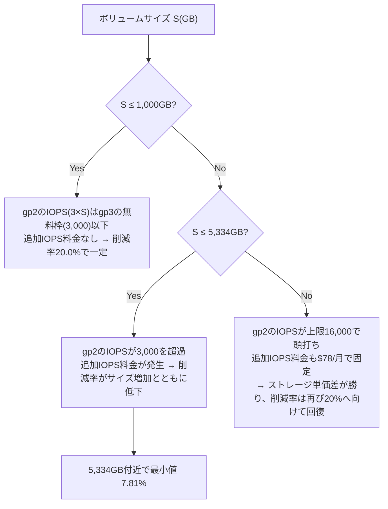

## TL;DR

- 2026年11月8日、AWS Price List Bulk API（認証不要の公開エンドポイント）から東京リージョンのEBS単価を取得して検証した。
- ストレージ単価は、gp2が**$0.12/GB-月**、gp3が**$0.096/GB-月**。単純な単価差は**20.0%**で、AWSが案内する「gp3はgp2より最大20%安い」という数字と一致する。
- ただしgp3の無料ベースラインIOPS（3,000）とスループット（125MiB/s）はボリュームサイズに関係なく一定である。一方gp2のベースラインIOPSはサイズに比例する（3 IOPS/GB、上限16,000 IOPS）ため、ボリュームが**1,000GBを超えると**、gp2と同じIOPSをgp3で確保するために追加IOPS料金（$0.006/IOPS-月）が発生し始める。
- gp2のIOPSが上限16,000に達するのは**5,334GB**。この付近で、gp3側のIOPSをgp2に揃えた場合の実質削減率は**7.81%**まで下がる。見出しの20%の半分にも届かない。
- 5,334GBを超えると、gp2側のIOPSは16,000で頭打ちになり追加IOPS費用も一定額（$78/月）で固定される。一方ストレージの単価差（0.024ドル×GB）はサイズに比例して伸び続けるため、削減率は再び20%に向けて回復していく。
- 本記事で揃えているのはIOPSのみ。スループット（MiB/s）側の整合条件は、gp2の正確な算出式を本セッションから公式ドキュメントで確認できなかったため含めていない（詳細はQ&A参照）。

## 背景: 「最大20%安い」という見出しの前提

Amazon EBSのgp3ボリュームは、gp2の後継として「同じ性能ならより安い」という文脈でよく紹介される。特に「gp3はgp2より最大20%安い」という数字は、料金比較の記事やコスト最適化の提案でよく見かける。

この数字自体は単価の比較としては正しい。問題は、gp2とgp3でIOPS・スループットの「無料で付いてくる量」の決まり方が違う点だ。

- **gp2**: ボリュームサイズ1GBあたり3 IOPSが無料で付く（上限16,000 IOPS）。サイズが大きいほどIOPSも大きくなる。
- **gp3**: サイズに関係なく、常に3,000 IOPS・125MiB/sが無料で付く。それ以上のIOPS・スループットは追加料金で個別に購入する。

つまりgp2からgp3へ移行する際、「同じIOPSを維持する」という条件を付けると、ボリュームサイズによっては追加IOPS料金が発生し、単価差20%がそのまま効かなくなる。本記事はAWSコスト検証シリーズ（FSx／CodePipeline V2／Route53+CloudWatch死活監視／CodeBuild／CloudWatch Logs／S3 Standard-IA／NAT Gateway×VPC Endpoint）の続きとして、この「IOPSを揃えた場合の実質削減率」をAWS公式の単価データだけで検証する。

## 単価を取得する

AWS Price List Bulk APIは認証不要の公開エンドポイントで、追加コストもかからない。東京リージョン（ap-northeast-1）のEC2/EBS単価は次のコマンドで取得できる。

```bash
curl -s "https://pricing.us-east-1.amazonaws.com/offers/v1.0/aws/AmazonEC2/current/ap-northeast-1/index.json" \
  -o ec2_tokyo.json
```

ファイルサイズは2026年11月8日時点で約426MBあるため、`jq`などのストリーミング処理、またはPythonの`json`モジュールで読み込んで、`productFamily`が`Storage`（ストレージ単価）・`System Operation`（追加IOPS単価）・`Provisioned Throughput`（追加スループット単価）で、`volumeApiName`が`gp2`または`gp3`の項目だけを抜き出す。

抜き出した結果、2026年11月8日時点で次の単価が確認できた。

| 項目 | ボリューム種別 | 単価（東京リージョン） |
| --- | --- | --- |
| ストレージ | gp2 | $0.12 / GB-月 |
| ストレージ | gp3 | $0.096 / GB-月 |
| 追加IOPS（ベースライン3,000超過分） | gp3 | $0.006 / IOPS-月 |
| 追加スループット（ベースライン125MiB/s超過分） | gp3 | $0.048 / MiB/s-月 |

gp2には追加IOPS・追加スループットの単価そのものが価格リストに存在しない。これはgp2が「ボリュームサイズに応じて自動的にIOPS・スループットが決まる」仕組みで、個別に追加購入する発想がないためだ（ボリュームサイズに依存しないIOPSが必要な場合は、io1/io2などプロビジョンドIOPS SSDを使う）。

## 検証: サイズSのボリュームで、IOPSを揃えた実質削減率

gp2のベースラインIOPSは次の式で決まる（公開されている一般的な仕様。サイズに比例、上限16,000）。

```
gp2のIOPS = min(3 × S, 16000)   ※Sはボリュームサイズ(GB)
```

gp3はサイズに関係なく3,000 IOPSが無料なので、gp2と同じIOPSをgp3で確保するために必要な追加IOPS料金は次の式になる。

```
追加IOPS料金 = max(0, gp2のIOPS − 3000) × $0.006
```

この条件で、gp2のコストと「gp2と同じIOPSを確保したgp3」のコストを比べたのが次の表だ。

| サイズS | gp2のIOPS | gp2の月額 | gp3（IOPS揃え済み）の月額 | 削減額 | 削減率 |
| ---: | ---: | ---: | ---: | ---: | ---: |
| 100GB | 300 | $12.00 | $9.60 | $2.40 | 20.00% |
| 500GB | 1,500 | $60.00 | $48.00 | $12.00 | 20.00% |
| 1,000GB | 3,000 | $120.00 | $96.00 | $24.00 | 20.00% |
| 2,000GB | 6,000 | $240.00 | $210.00 | $30.00 | 12.50% |
| 3,000GB | 9,000 | $360.00 | $324.00 | $36.00 | 10.00% |
| 4,000GB | 12,000 | $480.00 | $438.00 | $42.00 | 8.75% |
| 5,334GB | 16,000 | $640.08 | $590.06 | $50.02 | **7.81%** |
| 6,000GB | 16,000（上限） | $720.00 | $654.00 | $66.00 | 9.17% |
| 10,000GB | 16,000（上限） | $1,200.00 | $1,038.00 | $162.00 | 13.50% |
| 20,000GB | 16,000（上限） | $2,400.00 | $1,998.00 | $402.00 | 16.75% |
| 50,000GB | 16,000（上限） | $6,000.00 | $4,878.00 | $1,122.00 | 18.70% |



数字で見ると、傾向は3段階に分かれる。

1. **1,000GB以下**: gp2のIOPS（3×S）はgp3の無料枠3,000を超えないため、追加IOPS料金が一切発生しない。ストレージ単価差だけが効き、削減率は一律**20.0%**。
2. **1,000GB〜5,334GB**: gp2のIOPSが3,000を超え、追加IOPS料金が発生し始める。ボリュームが大きくなるほど追加IOPS料金も増え、削減率はサイズに反比例して下がる。5,334GB（gp2のIOPSが上限16,000に達する点）で最小値**7.81%**になる。
3. **5,334GB超**: gp2のIOPSは16,000で頭打ちになるため、追加IOPS料金も$78/月（超過IOPS13,000分×$0.006）で固定される。一方ストレージ単価差（0.024ドル×S）はサイズに比例して増え続けるため、削減率は再び20%に向かって回復していく。

つまり「gp3は最大20%安い」という見出しが正確に成立するのは、1,000GB以下の小〜中規模ボリュームと、十分に大きい大容量ボリュームの両端であり、1,000GB〜5,334GB付近の中間サイズでは、IOPSを維持する前提だと実質的な削減率は半分以下まで下がる。

## Q&A

**Q. gp2のIOPS計算式（3 IOPS/GB、上限16,000）は公式ドキュメントで確認したのか。**
A. いいえ。この仕様自体は広く知られている長期的に安定したEBSの仕様だが、本セッションのネットワーク環境からは`aws.amazon.com`・`docs.aws.amazon.com`に接続できず、本記事の執筆時点で公式ドキュメントで再確認はできていない。数値を使う前に、必ず公式ドキュメントで現在の仕様を確認してほしい。

**Q. スループット（MiB/s）側は検証していないのか。**
A. していない。gp3の追加スループット単価（$0.048/MiB/s-月、ベースライン125MiB/s）はAWS Price List Bulk APIで確認できたが、gp2のスループットがボリュームサイズ・IOPSからどう決まるかの正確な算出式を、本セッションから公式ドキュメントで確認できなかった。不正確な式で計算すると数値の信頼性が落ちるため、本記事ではIOPSのみを揃えた比較にとどめている。

**Q. 実際に移行する場合、どちらを選ぶべきか。**
A. 本記事はIOPSを「gp2と完全に同じ値まで揃える」という保守的な前提で削減率を出している。実際のワークロードがgp2のベースラインIOPSを使い切っていないなら、gp3でIOPSを揃える必要はなく、削減率は表の数字より大きくなる。逆に、ボリュームサイズに比例した高いIOPSを本当に必要としているワークロードでは、本記事の数字がそのまま当てはまる。

**Q. 単価は今も有効か。**
A. いいえ。本記事の単価は2026年11月8日にAWS Price List Bulk APIから取得した値である。リージョンや時期によって変わるため、実際に検討する際はAWS公式のEBS料金ページで必ず確認してほしい。

## 得られた知見・まとめ

- 「gp3はgp2より最大20%安い」という数字は、単純なGB単価の比較としては正確（東京リージョンで$0.12→$0.096、ちょうど20.0%）。
- しかしgp2のベースラインIOPSはサイズに比例し、gp3のベースラインIOPSはサイズに関係なく一定（3,000）という前提の違いがあるため、「同じIOPSを維持する」条件を付けると、1,000GBを超えたあたりから実質削減率は20%より小さくなる。
- 最も削減率が下がるのは、gp2のIOPSが上限16,000に達する5,334GB付近で、実質**7.81%**まで下がる。見出しの数字の半分以下になる。
- 5,334GBを超える大容量ボリュームでは、gp2側のIOPSが頭打ちになる一方ストレージの単価差は伸び続けるため、削減率は再び20%に近づいていく。削減率がサイズによって一様ではなく、谷を持つ形になっている点が今回の検証のポイント。
- 移行前に「自分のワークロードが実際にどれだけIOPSを使っているか」を先に確認しないと、このような中間サイズのボリュームで想定より小さい削減額しか出ない可能性がある。

## 参考リンク

このセッションのネットワーク環境では`aws.amazon.com`・`docs.aws.amazon.com`への接続が許可されておらず、AWS公式の料金ページ・ドキュメントのURLをcurlでHTTPステータス確認できなかった。そのため、本記事の検証に使った単価データの取得元（curlでHTTP 200を確認済み）のみを参考リンクとして載せる。

- [AWS Price List Bulk API（オファーインデックス）](https://pricing.us-east-1.amazonaws.com/offers/v1.0/aws/index.json)
- [AWS Price List Bulk API（Amazon EC2・東京リージョン、EBS単価を含む）](https://pricing.us-east-1.amazonaws.com/offers/v1.0/aws/AmazonEC2/current/ap-northeast-1/index.json)

最新の料金・IOPS/スループットの仕様については、AWS公式の「Amazon EBSの料金」ページと「Amazon EBSボリュームタイプ」ユーザーガイドで確認してほしい。
