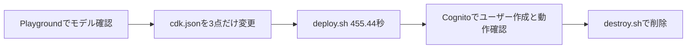
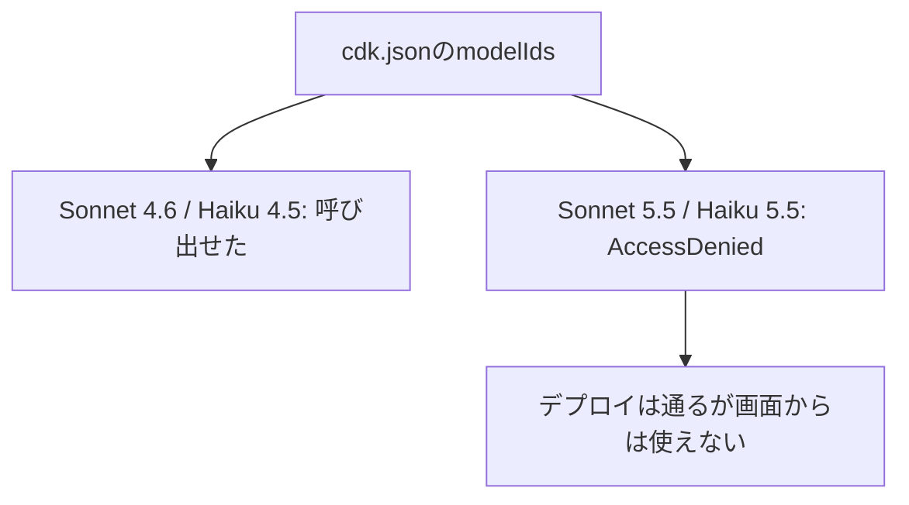

## 結論

- AWS公式OSS「GenU(generative-ai-use-cases)」は、**CloudShellだけで、デプロイ完了まで455.44秒**だった(東京リージョン、RAGなし構成)。
- つまずきは、デプロイ自体よりも**Bedrockのモデル有効化まわり**に集中した。
- 検証環境は、検証が終わったらすぐ `destroy.sh` で削除する前提で組んだ。

## 検証環境の前提

- 実行場所: CloudShell(ap-northeast-1)
- モデル呼び出しリージョン: us-east-1
- 設定(`cdk.json`): `selfSignUpEnabled: false`、`modelIds` は `global.anthropic.claude-sonnet-4-6` のみ、RAGは無効(OpenSearchなど常時課金のリソースを作らない構成)
- デプロイ: 公式の `deploy.sh` に `--cdk-context` で自分の `cdk.json` を渡す

## 手順(要点)

1. Bedrock Playgroundで、使うモデルが呼べることを先に確認する
2. 公式の `cdk.json` をベースに、上の3点だけ書き換えてCloudShellへアップロードする
3. `deploy.sh` を実行する(完了まで455.44秒)
4. Cognitoでユーザーを作成し、ログインして動作確認する

全体の流れは次のとおりです。

## つまずき1: Model accessのページが廃止されていた

古い解説では「Bedrockの Model access でモデルを有効化する」とありますが、このページは**廃止されていました**。現在は、モデルを初めて呼び出した時点で自動的に有効化されます。Anthropicのモデルは、初回にユースケースの申請フォームの提出が必要でした。

## つまずき2: 新しい世代のモデルが AccessDenied になる

同じアカウントで試した結果は次のとおりです。

| モデル | 結果 |
|---|---|
| Claude Sonnet 4.6 | 呼び出せた |
| Claude Haiku 4.5 | 呼び出せた |
| Claude Sonnet 5.5 | AccessDeniedException |
| Claude Haiku 5.5 | AccessDeniedException |

エラー文には「AWS Sales に連絡」といった内容が出ました。原因はアカウント側の制限と思われますが、特定できていません。**`cdk.json` の `modelIds` に新モデルを入れると、デプロイは通っても画面からは使えない**ので注意が必要です。

結果を図にすると、次のようになります。

## 実測: トークン数(検証時)

| ユースケース | 入力トークン | 出力トークン |
|---|---|---|
| 長めの設計相談(チャット) | 288 | 1,183 |
| 要約(上の回答を要約) | 1,425 | 699 |

## 使ってみて気づいたこと

- 議事録生成: 入力した文字起こしにない**年(2024年)を補って出力**することがあった。日付は人が確認する前提にすべき。
- 画面: 下部の入力欄と「最初からやり直す」ボタンが、内容に重なって見えることがある。
- 履歴はサイドバーに自動で並ぶ。

## 費用(実測)

検証期間は11/3〜11/7(デプロイから削除まで)で、Cost Explorerのサービス別内訳(11/1〜11/6、UTC基準)は次のとおりです。

| サービス | 金額 |
|---|---|
| Claude Sonnet 4.6(Bedrock Edition) | $0.10(11/4のみ) |
| CloudFront / Lambda / Cognito / DynamoDB / API Gateway / CloudFormation / CloudWatch | いずれも $0.00 |

- 検証1回の費用は、ほぼBedrockの$0.10だけでした。RAGなし・モデル1つの構成なので、常時課金されるリソースがないためです。
- 注意点として、同じ月の請求にはGenUと無関係な固定費(別サービスの月額など)が混ざります。**GenUの費用は、必ずサービス名で絞って見てください。**
- 表示は小数点以下で丸められています。11/7分は、記事執筆時点でまだ反映されていません。

## 片付け

CloudShellで `destroy.sh` を実行して削除しました(11/7)。

- 確認プロンプトに `yes` と答えると、`cdk destroy --all` が走ります。
- 削除対象は、東京の `GenerativeAiUseCasesStack` と、us-east-1の `VideoTmpBucketStack` の2つです。
- CloudFrontの削除に数分かかります。完了すると「GenU has been successfully destroyed」と表示されます。
- CloudFormationの一覧から、GenUのスタックが消えたことを確認しました。
- `CDKToolkit`(CDK共通のスタック)は残ります。S3バケットが1つ残りますが、料金はごく少額です。

## まとめ

- デプロイは、CloudShellだけで十分に完結する。
- 時間を取られるのは、モデルの有効化と、新しいモデルの利用制限。
- 費用は、RAGなし・使い捨て前提なら小さい。検証一式で、GenU分はBedrockの$0.10だけだった。
