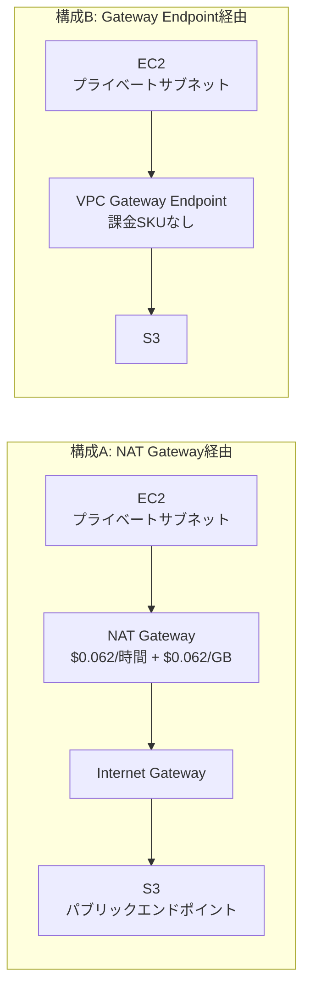

## TL;DR

- AWSコスト検証シリーズ（FSx／CodePipeline V2／Route53+CloudWatch死活監視／CodeBuild／CloudWatch Logs／S3 Standard-IA）の続き。今回はAmazon VPCのNAT Gatewayを、AWS Price List Bulk API（認証不要・公開エンドポイント）から取得した東京リージョンの単価で検証した。
- NAT Gatewayの単価は**$0.062/時間（基本料金）＋$0.062/GB（データ処理料）**。取得日2026-11-06時点。
- 「S3向けにVPC Gateway Endpointを足せば、NAT経由の転送費がゼロになる」という説明はよく見かけるが、ゼロになるのは**データ処理料（$0.062/GB）の部分だけ**。NAT Gateway自体が他の通信（外部API呼び出しやパッケージ取得など）のために稼働し続ける限り、**基本料金$0.062/時間（730時間換算で$45.26/月）は1円も減らない。**
- 月間500GBをNAT経由でS3へ送っているケースで計算すると、Gateway Endpoint導入で浮くのは月$31（データ処理料相当）。これはNAT Gatewayにこの経路以外の用途が無く、NAT Gateway自体を削除できる場合に浮く$76.26/月のうち**40.7%**に過ぎない。
- 単価は必ずAWS公式の料金ページで最新のものを確認してほしい。本記事の数字は2026-11-06時点でAWS Price List Bulk APIから取得した値を使った試算であり、将来の単価・リージョン・アカウント条件によって変わる。

## 背景：なぜこの組み合わせを検証したか

プライベートサブネットに置いたEC2から、インターネット経由でS3にアクセスする構成は珍しくない。VPC内にNAT Gatewayがあれば、EC2はパブリックIPを持たずにインターネット（および同一リージョンのS3パブリックエンドポイント）へ出ていける。

この構成に対して「VPC Gateway Endpoint（S3向け）を足せば、NAT Gatewayを経由せずにS3へ直接アクセスできるようになり、転送コストが下がる」という説明はよく見かける。実際、Gateway Endpointには時間課金もGB課金も無い。これ自体は事実で、後述するようにAWS Price List Bulk APIのデータでも裏付けが取れる。

ただしこの説明だけを読むと、「Gateway Endpointを足せばNAT Gatewayにかかっていた費用がまるごと消える」ように誤解しやすい。NAT Gatewayの請求には、GBあたりのデータ処理料とは別に、**稼働している時間そのものに対する基本料金**が存在する。この基本料金は、S3向けの通信をGateway Endpoint側に逃がしたところで、NAT Gateway自体が他の目的（外部SaaSへのAPI呼び出し、OSやミドルウェアのパッケージ取得など）のために稼働を続ける限り消えない。

今回は、この「消える部分」と「消えない部分」を、AWS公式の単価データだけを使って切り分けた。

## 検証：AWS Price List Bulk APIで単価を取得する

AWS Price List Bulk API は認証不要の公開エンドポイントで、東京リージョンの単価をJSONで取得できる。

```bash
# オファー一覧（Bulk APIのインデックス）
curl -s "https://pricing.us-east-1.amazonaws.com/offers/v1.0/aws/index.json" \
  -o idx.json

# NAT GatewayはAmazonEC2のオファーに含まれる（東京リージョン分、約450MB）
curl -s "https://pricing.us-east-1.amazonaws.com/offers/v1.0/aws/AmazonEC2/current/ap-northeast-1/index.json" \
  -o ec2_apne1.json

# VPC Endpoint関連はAmazonVPCのオファーに含まれる
curl -s "https://pricing.us-east-1.amazonaws.com/offers/v1.0/aws/AmazonVPC/current/ap-northeast-1/index.json" \
  -o vpc_apne1.json
```

`ec2_apne1.json` の `products` から、`usagetype` に `NatGateway` を含み、`group` が `NGW:NatGateway` のSKUを抽出すると、次の2つが見つかる（リージョン横断の `RegionalNatGateway` 系は今回対象外）。

| SKU | usagetype | 内容 |
|---|---|---|
| `CA23TN2NAN47KGCF` | `APN1-NatGateway-Hours` | NAT Gatewayの稼働時間課金 |
| `3Z2F4ZNXEMZB88ED` | `APN1-NatGateway-Bytes` | NAT Gatewayが処理したデータ量課金 |

それぞれの `terms.OnDemand` を見ると、価格は次の通りだった（2026-11-06時点）。

```
CA23TN2NAN47KGCF: $0.062 per NAT Gateway Hour
3Z2F4ZNXEMZB88ED: $0.062 per GB Data Processed by NAT Gateways
```

一方 `vpc_apne1.json` 側では、Interface型のVPC Endpoint（PrivateLink経由、S3以外のサービス向け）には `VPCE:VpcEndpoint` という課金グループが存在し、`APN1-VpcEndpoint-Hours`（時間課金）と `APN1-VpcEndpoint-Bytes`（データ量課金）の両方にSKUと価格が設定されている。これに対して、S3やDynamoDB向けのGateway型エンドポイントに対応する課金グループは、この価格リストの中に**存在しない**。課金対象のSKUが無いということは、時間課金もデータ量課金も発生しないことを意味する。これはAWSが長年公表している「Gateway Endpointは無料」という説明と一致する。

## 構成比較



構成Bにすると、EC2からS3への通信はNAT GatewayもInternet Gatewayも経由しなくなる。この経路の分だけ「データ処理料$0.062/GB」は発生しなくなる。ここまでは単価データからそのまま言える事実。

## 計算：消えるのは処理料だけ、基本料金は条件付き

ここからは、月間500GBをNAT経由でS3へ送っている、という前提を置いた試算。実際の自分の環境の転送量ではなく、比率を示すための例として500GBという丸い数字を使っている。

**NAT Gatewayの基本料金（稼働時間ぶん）**

```
$0.062/時間 × 730時間/月 ≒ $45.26/月
```

これはNAT Gatewayが1つ存在している限り、トラフィック量に関係なく発生する。

**S3向け500GB/月をNAT経由で送った場合のデータ処理料**

```
500GB × $0.062/GB = $31.00/月
```

**Gateway Endpointを追加してS3向け通信をNATから逃がした場合**

- 消えるもの: データ処理料 $31.00/月（この経路の分だけ）
- 消えないもの: NAT Gatewayの基本料金 $45.26/月（他の用途でNATがまだ必要な限り）

この例でNAT Gatewayに関連する費用の合計は、Gateway Endpoint導入前が $45.26 + $31.00 = $76.26/月。導入後、他の目的（外部API呼び出し等）でNAT Gatewayがまだ必要なら $45.26/月が残り、実際に減るのは $31.00/月。これは導入前の合計$76.26に対して **40.7%** にあたる。

NAT Gatewayを他の用途でも一切使っておらず、S3向け通信だけのためにNAT Gatewayを維持していたケースに限り、Gateway Endpoint導入後にNAT Gateway自体を削除できる。その場合は基本料金ぶんも含めて $76.26/月（100%）が浮く。「浮く割合」はNAT Gatewayに他の用途があるかどうかで40.7%にも100%にもなる、という点が今回の検証の要点。

## Q&A

**Q. Gateway EndpointでS3向け通信を逃がせば、NAT Gatewayは必ず削除できるのか。**
A. いいえ。NAT Gatewayはプライベートサブネットから外部インターネットへ出る通信全般（S3以外のSaaS API呼び出し、OS/ミドルウェアのパッケージ取得など）にも使われていることが多い。S3向けの通信だけをGateway Endpoint経由に変えても、他の送信先への経路としてNAT Gatewayが必要であれば、基本料金はそのまま残る。

**Q. 同一リージョン内のS3への通信なら、そもそもデータ転送自体は無料ではないのか。**
A. ここで発生する$0.062/GBは「S3へのデータ転送料金」ではなく「NAT Gatewayが処理したデータ量に対する課金」であり、別の課金項目になる。通信の宛先がどこであっても、NAT Gatewayを経由した時点でこの処理料は発生する。

**Q. Interface型のVPC Endpoint（PrivateLink）ではなく、S3はなぜGateway型なのか。**
A. S3とDynamoDBは歴史的にGateway型エンドポイント（ルートテーブルにエントリを追加する方式）のみ、または追加でInterface型も選べる形で提供されている。今回の検証対象であるS3向けGateway型は、価格リストに課金SKUが存在しないことからも無料であることが裏付けられる。

**Q. この単価をそのまま自分の見積もりに使っていいか。**
A. いいえ。本記事の単価は2026-11-06時点でAWS Price List Bulk APIから取得した値であり、将来変更される可能性がある。実際に検討する際は、AWS公式の料金ページまたはAWS Pricing Calculatorで必ず最新の値を確認してほしい。また、500GB/月という数値は比率を示すための仮の例であり、実測のトラフィック量ではない。

## 得られた知見・まとめ

- NAT Gatewayの請求は「稼働時間に対する基本料金」と「処理したデータ量に対する処理料」の2本立てで、Gateway Endpointの追加で消せるのは後者（処理料）だけ。基本料金はNAT Gateway自体を削除しない限り残る。
- 「Gateway Endpointで転送コストがゼロになる」という見出しは、処理料の部分に限れば正しい。ただし記事や説明がどちらの課金項目を指しているかを区別していないと、基本料金まで消えると誤解しやすい。
- 今回の試算例（月500GBをNAT経由でS3へ）では、Gateway Endpoint導入で実際に浮くのは全体の40.7%（データ処理料のみ）。NAT Gatewayを完全に削除できる条件（他の用途が一切ない）が揃って初めて100%浮く。
- コスト削減の提案を評価するときは、「何パーセント安くなるか」だけでなく、その削減が課金項目のどの部分に効いているのか、そして自分の環境がその条件（NAT Gatewayの他用途の有無）に当てはまるのかを先に確認したほうがよい。

## 参考リンク

- [AWS Price List Bulk API: オファー一覧](https://pricing.us-east-1.amazonaws.com/offers/v1.0/aws/index.json)
- [AWS Price List Bulk API: AmazonEC2（東京リージョン、NAT Gateway単価を含む）](https://pricing.us-east-1.amazonaws.com/offers/v1.0/aws/AmazonEC2/current/ap-northeast-1/index.json)
- [AWS Price List Bulk API: AmazonVPC（東京リージョン、VPC Endpoint単価を含む）](https://pricing.us-east-1.amazonaws.com/offers/v1.0/aws/AmazonVPC/current/ap-northeast-1/index.json)
