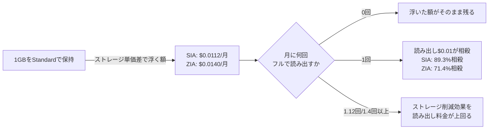

## TL;DR

- 2026年11月1日、AWS Price List Bulk API（認証不要の公開エンドポイント）から東京リージョン（ap-northeast-1）のAmazon S3の単価を取得して検証した。
- ストレージ単価は、Standardが**$0.025/GB・月**、Standard-IA（SIA）が**$0.0138/GB・月**。見出しにしやすい数字としては、SIAへの移行で**44.8%のストレージ削減**になる。
- ただしSIAには、取り出したバイト数に関係なく課金される**読み出し（Retrieval）料金 $0.01/GB・フラット**がある。
- 1GB分のデータを月に1回フルで読み出すだけで、ストレージ削減で浮いた$0.0112のうち$0.01が消え、**浮いた分の89.3%が相殺される**。
- 月に1.12回以上読み出すと、ストレージ削減効果そのものが読み出し料金で食いつぶされ、Standardのままのほうが安くなる。

## 背景:「IAへ移行すればストレージ代が浮く」は定番の節約Tipsだが、読み出し頻度を無視している

S3のコスト削減Tipsとして、「アクセス頻度が落ちたデータはStandard-IAやOne Zone-IA（ZIA）に移行する」はよく紹介される。ストレージ単価だけを見れば、確かにIAのほうが安い。

ただしS3のIA系ストレージクラスは、「ストレージ単価は安いが、読み出すたびに追加料金がかかる」という設計になっている。ライフサイクルルールを設定するとき、移行先のストレージ単価だけを見て「●●%削減できる」と判断し、読み出し頻度を検討せずに移行すると、実際のコストは見出しの数字から大きく外れる。

本記事はAWSコスト検証シリーズ（FSx、CodePipeline V2、Route53+CloudWatchの死活監視、CodeBuild、CloudWatch Logs）の続きとして、S3のストレージクラス選択を、公式の単価データだけを使って検証する。

## 単価を取得する

AWS Price List Bulk APIは認証不要で、追加コストもかからない公開エンドポイントである。東京リージョンのAmazon S3の単価は次のコマンドで取得できる。

```bash
curl -s "https://pricing.us-east-1.amazonaws.com/offers/v1.0/aws/AmazonS3/current/ap-northeast-1/index.json" \
  -o s3_tokyo.json
```

取得したJSON（約510KB）から、`usagetype`が各ストレージクラスの`TimedStorage-ByteHrs`系と、`API Request`カテゴリの項目を抽出すると、2026年11月1日時点で次の値が確認できた。

| 項目 | ストレージクラス | 単価（東京リージョン） |
| --- | --- | --- |
| ストレージ | Standard（General Purpose） | $0.025 / GB・月（先頭50TB分） |
| ストレージ | Standard-IA（SIA） | $0.0138 / GB・月 |
| ストレージ | One Zone-IA（ZIA） | $0.011 / GB・月 |
| 移行リクエスト（PUT/COPY/POST/LIST） | SIA | $0.01 / 1,000リクエスト |
| 移行リクエスト（PUT/COPY/POST/LIST） | ZIA | $0.01 / 1,000リクエスト |
| 読み出し（Retrieval） | SIA | $0.01 / GB（取り出したバイト数に対するフラット課金） |
| 読み出し（Retrieval） | ZIA | $0.01 / GB（同上） |

ストレージ単価だけを比較すると、SIAはStandardの**44.8%オフ**、ZIAは**56.0%オフ**になる。

```
(0.025 - 0.0138) / 0.025 = 0.448 → 44.8%
(0.025 - 0.011)  / 0.025 = 0.560 → 56.0%
```

この44.8%・56.0%という数字が、「IAへ移行すればコストが半分近く減る」という見出しになりやすい部分である。

## 検証:読み出し頻度を加味すると、見出しの数字はどこまで残るか

ストレージ単価の差額（=移行で浮く額）を1GB・1か月あたりで計算すると、次のようになる。

```
SIA: 0.025 - 0.0138 = 0.0112 ドル/GB・月
ZIA: 0.025 - 0.011  = 0.0140 ドル/GB・月
```

ここに、読み出し料金$0.01/GBを重ねる。1GBのデータを月に1回フルで読み出すと、浮いたはずの$0.0112（SIA）・$0.0140（ZIA）から$0.01が消える。



| 月あたりの読み出し回数 | SIA 実質削減額/GB | SIA 相殺率 | ZIA 実質削減額/GB | ZIA 相殺率 |
| --- | --- | --- | --- | --- |
| 0回 | $0.0112 | 0% | $0.0140 | 0% |
| 1回 | $0.0012 | 89.3% | $0.0040 | 71.4% |
| 1.12回 | $0.0000 | 100%（損益分岐点） | ― | ― |
| 1.4回 | ― | ― | $0.0000 | 100%（損益分岐点） |
| 2回 | -$0.0088（赤字） | 178.6% | -$0.0060（赤字） | 142.9% |

損益分岐点（ストレージ削減額と読み出し料金が等しくなる回数）は次の式で求まる。

```
SIA: 0.0112 ÷ 0.01 = 1.12回/月
ZIA: 0.0140 ÷ 0.01 = 1.4回/月
```

つまり、SIAは月に1.12回より多くデータ全体を読み出すと、ストレージ削減効果がマイナスに転じる。「アクセス頻度が落ちたデータ」をIAに移すという判断自体は正しいが、「どれくらい落ちたか」を数値で確認しないと、月1〜2回のバッチ処理や月次集計で全データを読み出すだけで、削減効果の大半、あるいは全部を失う。

なお、大量の小さいオブジェクトを一括でIAへ移行する場合は、移行自体（PUT/COPY/POST/LIST）にも$0.01/1,000リクエストの課金が発生する。たとえば100万オブジェクトを移行すると、移行コストだけで$10かかる。これは一度きりの課金なのでストレージ削減効果に対しては小さいが、オブジェクト数が多い場合は無視できる金額ではない。

## Q&A

**Q. ストレージ単価が安いIAを使わないほうがいいということですか?**
A. そうではない。「本当にアクセス頻度が低いデータ」であればIAへの移行は有効。重要なのは、移行前に自分のワークロードの読み出し頻度（月に何回、何GB読むか）を実測し、損益分岐点（SIAなら月1.12回、ZIAなら月1.4回）と比較すること。頻度を確認せずに「ストレージ単価が安いから」だけで移行すると、今回の検証のように逆効果になり得る。

**Q. 読み出し料金はアクセスごとの課金ですか、それとも取り出したバイト数に対する課金ですか?**
A. 取り出したバイト数に対するフラット課金である（今回取得したデータでは「$0.01 per GB - flat fee for all bytes retrieved」と記載されている）。アクセス回数そのものに対する課金ではなく、小さいファイルを1回読んでも、大きいファイルを1回読んでも、読み出したバイト数に比例して課金される。

**Q. Standard-IAには最低保存期間や最小課金サイズなどの制約があると聞きますが、本記事では扱っていますか?**
A. 扱っていない。このセッションのネットワーク環境から`aws.amazon.com`・`docs.aws.amazon.com`に接続できず、最低保存期間や最小課金オブジェクトサイズといった制約の詳細を公式ドキュメントで確認できなかったため、本記事では単価の比較に絞っている。これらの制約は、今回の検証結果（読み出し頻度による相殺）にさらに不利な方向で効くことが多いため、移行を検討する際は必ず公式ドキュメントで確認してほしい。

**Q. この単価は今も有効ですか?**
A. いいえ。本記事の単価は2026年11月1日にAWS Price List Bulk APIから取得した値。リージョンや時期によって変わるため、実際に検討する際はAWS公式のS3の料金ページで必ず確認してほしい。

## 得られた知見・まとめ

- S3のストレージクラス選択を「ストレージ単価の削減率」だけで判断すると、読み出し料金を見落とす。SIAの「44.8%削減」という見出しの数字は、月1回のフル読み出しだけで89.3%相殺され、月1.12回を超えると逆転してStandardより高くなる。
- IA系ストレージクラスは「ストレージは安いが読み出しは高い」設計であり、向いているのは「長期間ほとんど読まないが、消すわけにはいかないデータ」。月次集計やバックアップの定期検証読み出しがあるデータは、想定より早く損益分岐点を超える。
- 判断に必要なのは、ストレージ単価の比較表ではなく、自分のワークロードの「月あたりの読み出し回数・読み出しバイト数」の実測値。これを出さずにライフサイクルルールだけ変更すると、今回のように効果が読めない施策になる。

## 参考リンク

このセッションのネットワーク環境では`aws.amazon.com`・`docs.aws.amazon.com`への接続が許可されておらず、AWS公式の料金ページ・ドキュメントのURLをcurlでHTTPステータス確認できなかった。そのため、本記事で検証に使った単価データの取得元（curlでHTTP 200を確認済み）のみを参考リンクとして載せる。

- [AWS Price List Bulk API（オファーインデックス）](https://pricing.us-east-1.amazonaws.com/offers/v1.0/aws/index.json)
- [AWS Price List Bulk API（Amazon S3・東京リージョン）](https://pricing.us-east-1.amazonaws.com/offers/v1.0/aws/AmazonS3/current/ap-northeast-1/index.json)

最新の料金・ストレージクラスごとの制約については、AWS公式の「Amazon S3の料金」ページで確認してほしい。
