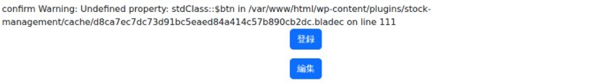

## 結論

- wp-env を `WP_DEBUG: true` のまま、Playwright でE2Eを動かすと、**PHPの警告・非推奨がHTMLの中に直接出力され、テストが壊れる**。
- 実際に起きたのは、次の3つだった。
  1. 同じidの要素が2つに一致して、セレクタが止まった(5件が同時に失敗)。
  2. **hidden入力の `value` に警告文が入り、確認画面の「登録」ボタンが「更新」に化けた**。
  3. 確認画面で `exec_action is not defined` となり、登録ボタンを押しても、通信が1本も出なかった(**原因は未検証**)。
- 警告の表示を止めれば直る、と言いたいところだが、**表示を止めると、DBエラーをページ内の文字列で検出する方法も使えなくなる**。この記事では、その見極めまで書く。

## 環境

- wp-env(PHP 8.1)、Playwright(Chromium)、GitHub Actions(ubuntu-latest)
- `.wp-env.json` の設定(抜粋)

```json
{
  "phpVersion": "8.1",
  "config": {
    "WP_DEBUG": true,
    "WP_DEBUG_LOG": true
  }
}
```

`WP_DEBUG_DISPLAY` は書いていない。`WP_DEBUG` が true のとき、`WP_DEBUG_DISPLAY` の既定は「表示する」なので、**警告がページ内に出る設定**になっている。

- テストは、画面を開いて「`Fatal error` や `WordPress database error` という文字列が、ページに無いこと」を確認する形にした。

```ts
const FATAL = /Fatal error|Parse error|WordPress database error|Table '.*' doesn't exist|Uncaught/;
await expect(page.locator('body')).not.toContainText(FATAL);
```

この確認のおかげで、後述のとおり、スキーマの不足を何度も見つけられた。つまり、**警告を表示することには、実際に価値があった**。

## 症状1: 同じidの要素が2つに一致する

ログインだけの3件から始めて、画面表示のテストを足した段階で、5件が同時に失敗した。

```
Error: strict mode violation: locator('#wpbody-content') resolved to 2 elements:
    1) <div id="wpbody-content">…</div> aka getByText('Warning: Undefined property: stdClass::$cmd in /var/www/html/wp-content/plugins')
    2) <div id="wpbody-content">…</div> aka locator('#wpbody-content').nth(1)
```

画面は開いている。ただ、`#wpbody-content` が2つあり、片方の中に、PHPの警告文が入っていた。Playwrightは、複数の要素に一致するロケータでの `toBeVisible()` を、エラーにする(strict mode)。

対処は、最初の1つに絞るか、中身で絞ること。

```ts
await expect(page.locator('#wpbody-content').first()).toBeVisible();
await expect(page.locator('#the-list', { hasText: '2026-11-16' }).first()).toBeVisible();
```

- 修正前: 48件成功・5件失敗
- 修正後: 52件成功、そのあと別の原因(スキーマの列の不足)が1件見つかり、直したら53件すべて成功

## 症状2: hiddenの値に警告文が入り、「登録」が「更新」になる

新規登録のテストで、入力画面から「確認」を押し、確認画面で「登録」を押す流れを書いた。確認画面で、次のエラーになった。

```
Error: locator.click: Test timeout of 30000ms exceeded.
  - waiting for locator('#cmd_regist')
```

確認画面には、「登録」ボタン(`#cmd_regist`)が無かった。代わりに、「更新」(`#cmd_update`)と「編集」(`#cmd_return`)が出ていた。

入力画面のDOMを、Playwrightのトレースから取り出したところ、hidden入力の `value` に、警告文が入っていた(パスは一部伏せている)。

```html
<input type="hidden" name="sales" value="
Warning: Undefined property: stdClass::$sales in /var/www/html/wp-content/plugins/<plugin>/cache/<hash>.bladec on line 68

Deprecated: htmlentities(): Passing null to parameter #1 ($string) of type string is deprecated in ... on line 68
">
```

日付の入力欄でも、ブラウザのコンソールに、同じ種類の警告が出ていた。

```
The specified value "\nWarning: Attempt to read property " does not conform to the required format, "yyyy-MM-dd".
```

仕組みは、こうなる。

1. テンプレートが、未定義の値を読む。
2. PHPが、警告を、出力に直接書き出す。
3. 警告は、`<input value="...">` を組み立てている最中に出力されるため、**属性の値の中に入る**。
4. 確認画面へ送るとき、`sales` に、警告文が入った状態で、POSTされる。
5. サーバー側は、「`sales` に値があれば、既存の受注の更新」とみなす実装だった。そのため、確認画面は、更新モードになり、「登録」ボタンが出なかった。

本番では、警告を表示しないので、`sales` は空のままになり、起きない。**CIだけで起きる、テスト環境に特有の不具合**だった。

### 実画面

確認画面の実際の表示。ボタンの上に、PHPの警告が、そのまま出ている(CIのスクリーンキャストから切り出した)。



### テスト側の対処

確認ボタンを押す前に、`sales` の値を空にする。本番と同じ状態で送る、という意味になる。

```ts
// CIは WP_DEBUG でPHPの警告をページに表示するため、隠し欄 sales の値に警告文が混ざる。
// 本番と同じく、新規登録では sales を空にして送る。
await page.evaluate(() => {
  document.querySelectorAll<HTMLInputElement>('[name="sales"]').forEach((e) => {
    e.value = '';
  });
});
```

これで、確認画面に「登録」ボタンが出るようになった(上の画像)。

## 症状3: 登録ボタンを押しても、通信が1本も出ない

「登録」を押すと、確認ダイアログ(`window.confirm`)が出る。テストは、ダイアログを `accept` していた。その後、保存のPOSTが、トレースの通信記録に1件も無かった。

原因を絞るため、テストにログを足した。

```ts
page.on('pageerror', (e) => console.log(`[pageerror] ${e.message}`));
const savePromise = page.waitForResponse(
  (r) => r.url().includes('action=save') && r.request().method() === 'POST',
  { timeout: 20000 },
);
```

CIのログは、こうなった。

```
[pageerror] exec_action is not defined
[save] 応答なし: page.waitForResponse: Timeout 20000ms exceeded while waiting for event "response"
```

「登録」ボタンのクリックは、`exec_action` という関数を呼ぶ。その関数が、確認画面で定義されていなかった。

**なぜ定義されていないのかは、検証していない。** 警告文が、`<script>` の中に混ざって、構文エラーになった可能性がある。ただし、確認画面のHTMLの `<script>` を、直接確認したわけではない。

> 「未検証」と書くのは、ここまで書いた2つの症状が「HTMLに警告が混ざる」で説明できても、3つ目は、同じ原因とは限らないため。

## 対策の比較

| 方法 | 良い点 | 悪い点 |
|------|--------|--------|
| テスト側で回避する(`.first()`、値を空にする) | 環境の設定を変えない | 画面ごとに、回避が増える。本番にない状態に合わせ続ける |
| `WP_DEBUG_DISPLAY: false` | 警告がHTMLに出ない。症状1〜3の根本に効く見込み | **DBエラーも、ページに出なくなる**。今の「ページ内の文字列で検出する」方法が、使えない |
| `WP_DEBUG: false` | いちばん手軽 | 警告もログも消え、テストがエラーを見逃す |

「警告を止める」だけでは、足りない。この環境では、ページ内に出る `WordPress database error` を探すことで、次のような不足を、何度も見つけた。

```
WordPress database error: [Unknown column 'st.transfer_fg' in 'SELECT']
```

だから、`WP_DEBUG_DISPLAY: false` にするなら、**`wp-content/debug.log` をテストの最後に読んで、DBエラーを検出する仕組みとセット**にする必要がある。

> この方法は、**まだ試していない**(次の検証で試す)。ここでは「こうする予定」であって、動作を確認した結果ではない。

## 実測値

- GitHub Actionsの1回の実行: 約2分20秒〜4分(wp-envの起動を含む)
- 実行されたテストの件数: 3件 → 53件 → 58件成功(64件中。1件は一時的に除外)
- 同じ原因(2要素に一致)で、同時に失敗したテスト: 5件

## Q&A

**Q. `WP_DEBUG_DISPLAY` を書かないと、どうなる?**
`WP_DEBUG` が true のとき、`WP_DEBUG_DISPLAY` の既定は「表示する」。表示したくない場合は、明示的に `false` にする必要がある。

**Q. 警告は、本番でも出る?**
本番は、通常、`WP_DEBUG` を false にして運用するので、警告はページに出ない。この記事の症状は、**CIのようにデバッグ表示を有効にした環境で、特に起きる**。

**Q. テスト側の回避だけで、運用してよい?**
小さく始めるなら、よい。ただし、画面を増やすたびに、回避が増える。3つ目の症状のように、原因が見えにくい失敗も出る。テストの数が増える前に、表示を止める方針を決めておくほうがよい。

## まとめ

- `WP_DEBUG` の警告表示は、E2Eのテストを、HTMLの中から壊す。値の中に入る場合は、**画面は正常に見えるのに、動作だけが変わる**。
- 警告を止める前に、**今の検出方法が、警告の表示に頼っていないか**を確認する。
- 止めるなら、`debug.log` を読んで、エラーを検出する仕組みを、一緒に用意する(この点は、次に検証する)。
