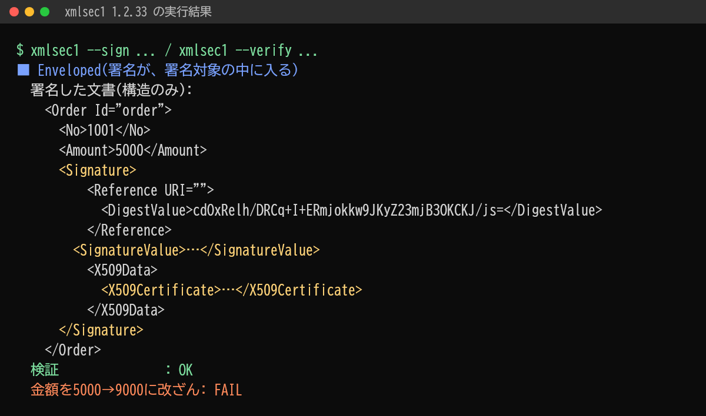
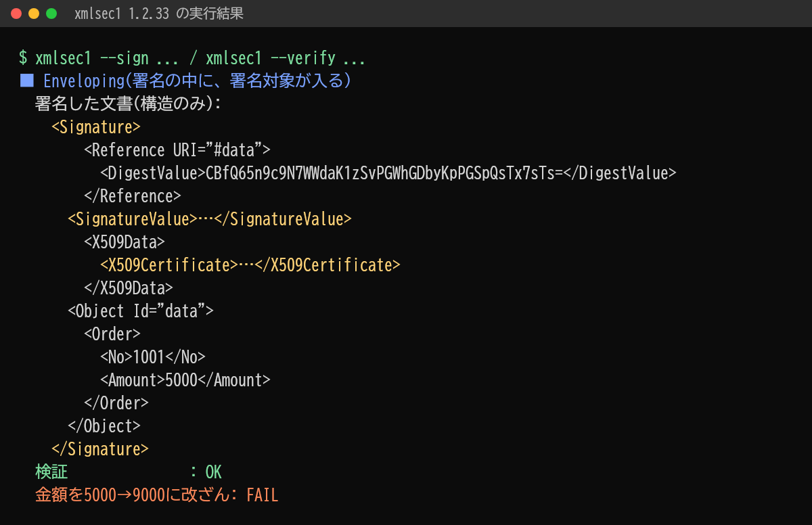
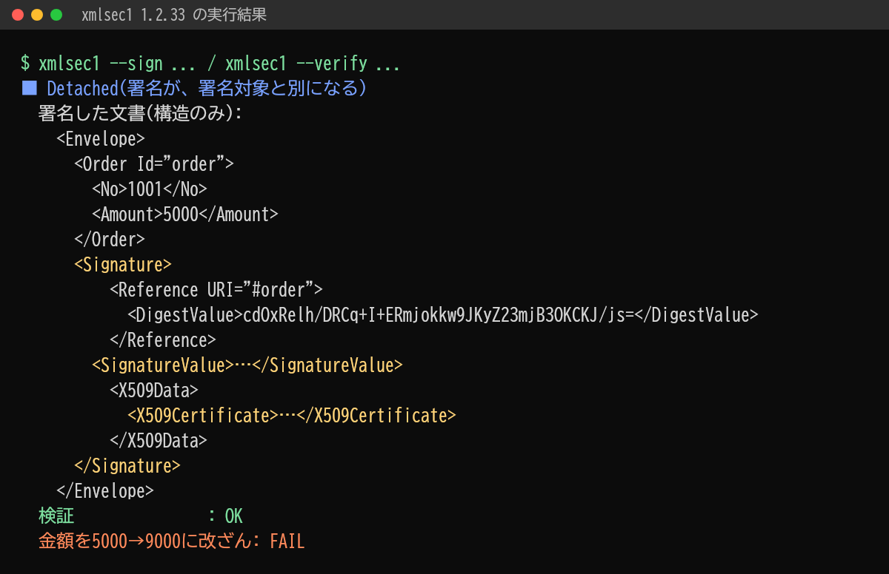

## はじめに

情報処理安全確保支援士の午前Ⅱに、XML署名の特徴を問う問題があります。
令和7年度 秋期 問6では、次の選択肢が正解でした。

> XML文書中のエレメントに対するデタッチ署名(Detached Signature)を作成し、同じXML文書に含めることができる。

(出典: [IPA 過去問題](https://www.ipa.go.jp/shiken/mondai-kaiotu/index.html)。選択肢の文を、短く引用しています。)

「デタッチ署名」と、「同じXML文書に含める」が、並んでいます。
署名が、署名対象と、別なのに、同じ文書に入る。
文字だけでは、イメージしにくかったため、`xmlsec1` で、実際に、署名・検証・改ざんして、確かめました。

この記事では、次のことを書きます。

- 電子署名の原理(`openssl` で確認)
- XML署名の3つの置き方(Enveloped / Enveloping / Detached)の違い
- 3つを、実際に署名・検証・改ざんして、比べた結果(スクリプトは、コピーして動かせます)
- 過去問の選択肢との対応

## 環境

- WSL2(Ubuntu 22.04)
- `openssl` 3.5.6
- `xmlsec1` 1.2.33(`apt install xmlsec1 libxml2-utils`)

## 電子署名の原理

署名は、「内容のハッシュ」を、秘密鍵で暗号化したものです。
公開鍵で検証して、一致すれば、改ざんがなく、鍵の持ち主が署名したと分かります。
まず、`openssl` で、原理を確かめます。

```bash
openssl genrsa -out priv.pem 2048
openssl rsa -in priv.pem -pubout -out pub.pem
printf "注文番号=1001\n金額=5000\n" > doc.txt
openssl dgst -sha256 -sign priv.pem -out doc.sig doc.txt
openssl dgst -sha256 -verify pub.pem -signature doc.sig doc.txt
```

| 試したこと | 結果 |
|---|---|
| 署名したまま、検証する | `Verified OK` |
| 内容を1か所変える(金額 5000→9000)と、検証する | `bad signature`(失敗) |
| 別の人の公開鍵で、検証する | `invalid padding`(失敗) |

署名の長さは、256バイト(RSA 2048ビット)でした。
内容が1か所違うだけで、ハッシュ値は、全く違う値になります。

## XML署名とは

XML署名は、署名を、XMLの形式で書く仕組みです。
署名の対象は、`<Reference URI="...">` で指します。
対象の「ダイジェスト(ハッシュ)」が、`<DigestValue>` に入り、それを署名した値が、`<SignatureValue>` に入ります。

署名と、署名対象の位置関係で、置き方が、3つに分かれます。
W3Cの勧告(XML Signature)で、この3つに分類されます。

| 置き方 | 意味 |
|---|---|
| Enveloped | 署名が、署名対象の**中**に入る |
| Enveloping | 署名の**中**に、署名対象が入る |
| Detached | 署名が、署名対象と**別**になる |

## 実験: 3つの置き方を、署名・検証・改ざんする

次のスクリプトは、3つの置き方の文書を作り、それぞれ、署名・検証し、金額を書き換えて、もう一度検証します。

```bash
# xmlsig.sh
#!/bin/bash
# XML署名の3つの置き方(Enveloped / Enveloping / Detached)を、xmlsec1 で、署名・検証・改ざん検知する。
set -u
W=/tmp/xmlsig; rm -rf $W; mkdir -p $W; cd $W
openssl genrsa -out key.pem 2048 2>/dev/null
openssl req -new -x509 -key key.pem -sha256 -days 30 -subj "/CN=Test Signer" -out cert.pem 2>/dev/null
DSIG='xmlns="http://www.w3.org/2000/09/xmldsig#"'
SI_HEAD='<SignedInfo><CanonicalizationMethod Algorithm="http://www.w3.org/2001/10/xml-exc-c14n#"/><SignatureMethod Algorithm="http://www.w3.org/2001/04/xmldsig-more#rsa-sha256"/>'
DIG='<DigestMethod Algorithm="http://www.w3.org/2001/04/xmlenc#sha256"/><DigestValue/>'
KI='<SignatureValue/><KeyInfo><X509Data/></KeyInfo>'

cat > t1.xml <<E
<?xml version="1.0" encoding="UTF-8"?>
<Order Id="order"><No>1001</No><Amount>5000</Amount><Signature $DSIG>$SI_HEAD<Reference URI=""><Transforms><Transform Algorithm="http://www.w3.org/2000/09/xmldsig#enveloped-signature"/></Transforms>$DIG</Reference></SignedInfo>$KI</Signature></Order>
E
cat > t2.xml <<E
<?xml version="1.0" encoding="UTF-8"?>
<Signature $DSIG>$SI_HEAD<Reference URI="#data">$DIG</Reference></SignedInfo>$KI<Object Id="data"><Order><No>1001</No><Amount>5000</Amount></Order></Object></Signature>
E
cat > t3.xml <<E
<?xml version="1.0" encoding="UTF-8"?>
<Envelope><Order Id="order"><No>1001</No><Amount>5000</Amount></Order><Signature $DSIG>$SI_HEAD<Reference URI="#order">$DIG</Reference></SignedInfo>$KI</Signature></Envelope>
E

run() { # 表示名 ファイル名 テンプレート
  local label=$1 n=$2 t=$3
  echo "■ $label"
  xmlsec1 --sign --privkey-pem key.pem,cert.pem --id-attr:Id Order --output $n.xml $t 2>&1 | head -3
  echo "  署名した文書(構造のみ):"
  xmllint --format $n.xml | sed -z -E 's/>[A-Za-z0-9+\/=[:space:]]{60,}</>…</g' | grep -vE "^\s*$" | grep -vE "CanonicalizationMethod|SignatureMethod|DigestMethod|KeyInfo|SignedInfo|Transforms|Transform |<\?xml" | sed 's/ xmlns="[^"]*"//' | sed 's/^/    /'
  printf "  検証               : "; xmlsec1 --verify --pubkey-cert-pem cert.pem --id-attr:Id Order $n.xml 2>&1 | grep -E "^(OK|FAIL)" | head -1
  sed 's/<Amount>5000<\/Amount>/<Amount>9000<\/Amount>/' $n.xml > $n-tampered.xml
  printf "  金額を5000→9000に改ざん: "; xmlsec1 --verify --pubkey-cert-pem cert.pem --id-attr:Id Order $n-tampered.xml 2>&1 | grep -E "^(OK|FAIL)" | head -1
  echo
}
run "Enveloped(署名が、署名対象の中に入る)" signed1 t1.xml
run "Enveloping(署名の中に、署名対象が入る)" signed2 t2.xml
run "Detached(署名が、署名対象と別になる)" signed3 t3.xml
```

```bash
bash xmlsig.sh
```

### Enveloped(署名が、署名対象の中に入る)



`<Order>` の中に、`<Signature>` が入っています。
`<Reference URI="">`(空)は、「この文書全体」を指します。
署名の中身を、署名の対象に含めてしまわないように、`enveloped-signature` という変換(Transform)を、指定します。

### Enveloping(署名の中に、署名対象が入る)



`<Signature>` が、いちばん外側です。
署名対象の `<Order>` は、`<Object Id="data">` の中に入り、`<Reference URI="#data">` で指されます。

### Detached(署名が、署名対象と別になる)



`<Order>` と、`<Signature>` が、並んでいます。
署名は、`<Reference URI="#order">` で、並んだ `<Order>` を指します。
署名対象を、署名の外に置けるため、署名対象は、そのまま読めます。

## 結果

| 置き方 | 署名したあとの形 | 検証 | 金額を 5000→9000 に改ざん |
|---|---|---|---|
| Enveloped | 署名対象の中に、`<Signature>` | OK | FAIL(検出) |
| Enveloping | `<Signature>` の中に、`<Object>` | OK | FAIL(検出) |
| Detached | 署名対象と、`<Signature>` が、並ぶ | OK | FAIL(検出) |

- 3つとも、ダイジェストを署名する仕組みは、同じです。違うのは、置き方だけです。
- どの置き方でも、内容を1か所変えると、検証が失敗しました。
- 署名しても、内容は、暗号化されません。署名後の文書でも、`<Amount>5000</Amount>` は、そのまま読めます。署名は、改ざんの検出と、署名者の確認のためのものです。

## 過去問の選択肢との対応

令和7年度 秋期 午前Ⅱ 問6の選択肢を、実験の結果と、照らします。

| 選択肢(要約) | 判断 |
|---|---|
| ア XML署名の構文には、CMS(Cryptographic Message Syntax)が用いられる | 誤り。実験のとおり、XML署名の構文は、XMLそのものです(`<SignedInfo>` など)。CMSは、別の署名形式です |
| **イ XML文書中のエレメントに対するデタッチ署名を作成し、同じXML文書に含めることができる** | **正解。** 実験の Detached のとおり、署名と署名対象が、並ぶ形で、同じ文書に入る |
| エ 署名対象と署名アルゴリズムは、ASN.1によって記述する | 誤り。実験のとおり、`<SignatureMethod>` などが、XMLで書かれています(ASN.1は、証明書などの形式です) |

(同じ種類の問題は、令和5年度 秋期 問4にも出ていました。)

## よくある誤解

**Q. 署名すると、内容が暗号化されますか。**
いいえ。実験の出力のとおり、署名後も、内容は、読めます。署名は、改ざんの検出と、署名者の確認のためです。

**Q. `xmlsec1 --verify` が OK なら、署名者を信頼できますか。**
今回の実験では、証明書に入っている公開鍵で、署名を検証しただけです。
その証明書が、信頼できる認証局から発行されたものかの検証(チェーンの検証)は、別の作業です。
署名の検証と、証明書の信頼の検証は、別です。

## まとめ

> 署名の対象を、ダイジェストにして署名する。置き方は、署名が、中に入る(Enveloped)、外側になる(Enveloping)、別になる(Detached)の3つ。

どの置き方でも、改ざんは、検証で、検出できます。
過去問の「デタッチ署名を作成し、同じXML文書に含める」は、署名と署名対象が、並ぶ形でした。
